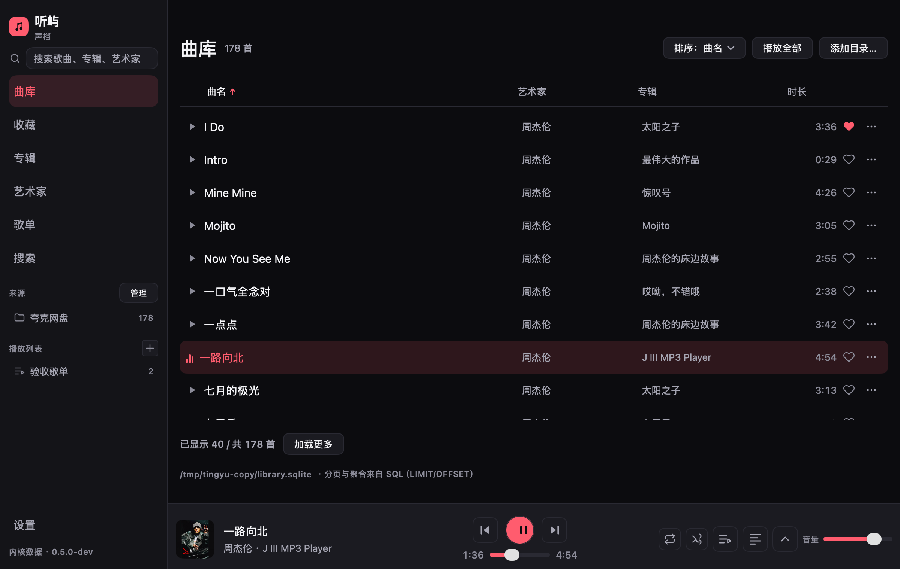
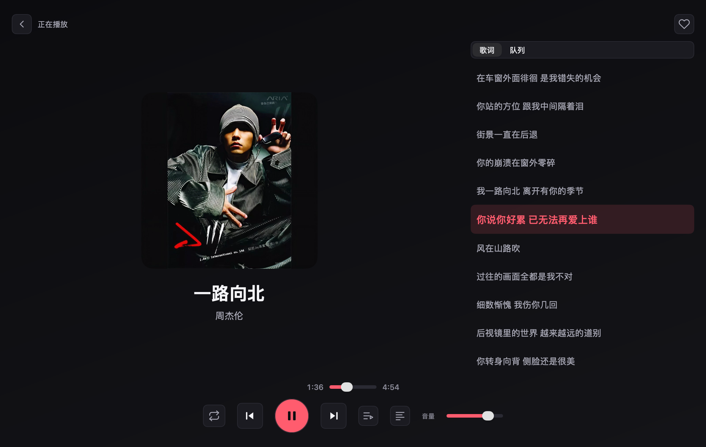
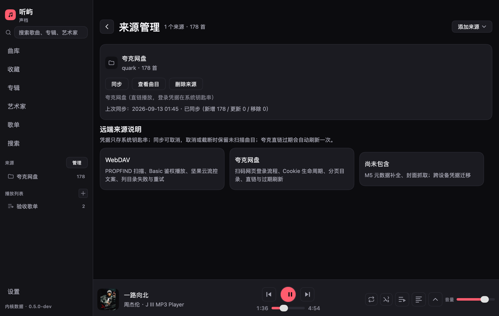

<!-- project-status:start -->
## 项目状态与入口

- **维护状态**：候选主线 · 保留项目，按实际使用需求投入。
- **项目入口**：现役代码位于 `client/`（Go + MyGo，macOS 单端），版本 0.1.0；构建、运行与数据目录见 [`client/README.md`](client/README.md)。
- **项目导航**：[全部项目与维护安排](https://github.com/halunhaku)。

<!-- project-status:end -->

# 听屿 (TINGYU)

> **连接本地文件夹、WebDAV 私人云与夸克网盘的 macOS 音乐播放器。**
> 现为 **macOS 单端**：唯一客户端是 Go + MyGo 重写的 `client/`——进程内 libmpv、系统媒体会话、SQLite 曲库；界面沿袭 Apple Music 的红粉强调色、磨砂材质与流体播放舞台（「声档」设计令牌）。

> [!NOTE]
> M7 收尾（2026-10-26）删除了 Flutter 客户端（`app/`，252 个文件）与残留的 Windows/Linux 工具链，删除前的完整快照在 tag **`archive/flutter-macos`**（找回命令见[下文](#数据目录备份与找回)）。
> 更早的 SwiftUI 实现冻结在 `legacy-swift/`，只作移植参考。`docs/` 是历史档案（迁移方案、M0–M7 记录、审计与调研），保留原文。

<p align="center">
  
  
  
  
  
</p>

---

## 界面预览

### 曲库主界面
侧栏（曲库 / 最近添加 / 艺术家 / 专辑 / 收藏 + 来源 + 播放列表）、带封面的曲目列表与底部悬浮播放条：

<p align="center">
  
</p>

### 全屏「正在播放」与待播清单
随封面取色的流体渐变舞台、超细进度条与传送器，右侧是实时待播队列：

<p align="center">
  
</p>

### 来源管理
夸克网盘 / WebDAV / 本地目录三类来源的同步状态、重新登录与添加入口：

<p align="center">
  
</p>

> 截图来自 `client/tools/screenshots`（同一个 `View` 经 `ui.Render` 以 1200×760 @2× 渲染）。`docs/screenshots/` 里还留着更早的 Flutter 版与 SwiftUI 版截图，作为历史对照。

---

## 特性亮点

### 1. 播放内核：进程内 libmpv 单引擎
- `purego` 直接 `dlopen` libmpv（无 cgo，`CGO_ENABLED=0` 可构建）：统一解码、gapless、任意 URL + 每曲自定义请求头；9 格式矩阵与 Range/seek 逐项验收。
- 系统媒体会话由 MyGo 的 `NowPlaying` 接通 macOS Now Playing 与媒体键；关窗继续播，`Cmd+Q` 干净退出。
- 队列懒解析 + 预取 2 + 世代号；循环三态与随机播放真的下发给内核/控制器；失败进快照并给出中文可执行提示，恢复后撤下。
- 加载失败不再静默：网络 / 鉴权 / 不存在 / 解码四类分类，带 HTTP 状态与引擎原文。

### 2. 三种音乐来源，原生直连
- **本地文件夹**：系统目录选择器授权后扫描入库，大小与修改时间未变则跳过解析。
- **WebDAV**：群晖 / 坚果云 / Nextcloud 等标准 WebDAV，PROPFIND 解析目录，带鉴权头取流。
- **夸克网盘**：应用内扫码 / Cookie 导入，目录挑选后动态换取 CDN 直链；直链过期自动刷新一次（换新 URI 重新装载）；Cookie 失效给「重新登录」而不是静默失败。
- 扫描合并以 `sourceId + filePathOrUrl` 对齐；只有权威扫描才移除旧曲，取消 / 截断 / 跳过都保留旧曲目及其收藏、歌单引用。

### 3. 多源元数据刮削与图片
- QQ 音乐 / 网易云 / iTunes / LRCLIB 四源降级抓取封面与歌词，繁简转换用 OpenCC 字表；可选 AI 兜底。
- 单曲「匹配元数据…」可在候选中人工挑一个覆盖，写回后列表与舞台立即刷新（无需重启）。
- 封面内容寻址落盘（FNV-1a，同图只存一份），删除来源/曲目后回收孤儿、共享封面保留；舞台按封面取主/次色，灰封面或取色失败回退中性令牌渐变。
- 歌词支持逐行与逐字两种渲染，逐字高亮是播放位置的纯函数。

### 4. 数据与凭据
- 曲库是 drift 时代的 SQLite（`tracks` / `music_sources` / `playlists` / `playlist_items`），`PRAGMA user_version` 冻结为 **2**；迁移只建缺失表/索引、只加可空列。
- 自 M7 起客户端默认读写真实曲库；`TINGYU_DATA_DIR` 指向副本、`TINGYU_READ_ONLY=1` 只读打开，是开发与验收用的两个开关。
- 夸克 Cookie、WebDAV 密码等凭据只进 macOS Keychain（`mygo.Secrets`，服务名 `com.halunhaku.tingyu.sources`）；没有明文回退，日志不落凭据与直链签名。
- 切换前自动备份 `library.sqlite`、`covers/`、`settings.json`（存在才复制）到 `.../backups/<timestamp>/`。

### 5. 分发与质量
- 内到外签名（framework 二进制 → framework → 可执行文件 → `.app`，绝不用 `--deep`），DMG 可选，公证 + 票据装订 + `spctl` 全流程；没有 Developer ID 凭据时如实降级为 ad-hoc 并明说。
- 只跑 macOS 的 CI：`gofmt -l` → `go vet` → `go test -race` → 打包 → `verify-bundle.sh`。
- 契约测试覆盖队列/循环三态/合并（取消不误删）/直链错误；键盘 100% 可达（Tab / 方向键 / 回车 / Esc）。

---

## 工程结构

```text
.
├─ client/                                    # 唯一客户端：Go + MyGo，macOS
│  ├─ main.go · mygo.json                     # 进程入口 · 应用名/bundle id/版本/最低系统
│  ├─ internal/                               # library · scan · mpv · player · sources · metadata
│  │                                          #   · enrich · images · ui(tokens/model/components/pages)
│  │                                          #   · shell · app · 各里程碑验收 harness
│  ├─ cmd/                                    # accept / sourceaccept / m5accept / scrubprobe（不随包发布）
│  ├─ tools/screenshots/                      # 同一 View 渲染各页深/浅截图
│  └─ scripts/                                # bundle.sh · verify-bundle.sh · fetch-frameworks.sh
│                                             #   · 冷启动/滚动/各里程碑验收脚本
├─ docs/                                      # 历史档案：迁移方案、M0–M7 记录、审计、调研、截图
│  ├─ plan/                                   #   含 2026-10-26-macos-mygo-m7-record.md
│  ├─ research/                               #   MyGo 可行性、音频生态、云音乐参考
│  └─ screenshots/
├─ spike/                                     # S1/S2 音频链路与媒体会话验证小样（Go，非产品代码）
├─ tools/legacy-export/                       # 旧版 SwiftUI 曲库的一次性导出工具（历史用途）
├─ legacy-swift/                              # 上一版 SwiftUI 实现，冻结保留
└─ .github/workflows/macos.yml                # 唯一的 CI（Go 客户端，只跑 macOS）
```

---

## 开发与构建

### 环境
- **Go 1.27+**（`client/go.mod` 固定 1.27.3），`CGO_ENABLED=0`
- **macOS 12+**，Xcode Command Line Tools（`codesign` / `otool` / `hdiutil`）
- MyGo 通过 `go tool mygo` 使用，无需单独安装

### 常用命令
```bash
cd client

./scripts/fetch-frameworks.sh              # 首次/CI：按钉住版本 + sha256 下载 mpv/FFmpeg frameworks → build/frameworks
./scripts/bundle.sh                        # → build/darwin-arm64/听屿.app（ad-hoc）
DMG=1 ./scripts/bundle.sh                  # 同时出 DMG
SIGN_IDENTITY="Developer ID Application: … (TEAMID)" NOTARY_PROFILE=notary DMG=1 ./scripts/bundle.sh

CGO_ENABLED=0 go build ./...
CGO_ENABLED=0 go vet ./...
go test ./... && go test -race ./...
gofmt -l .                                 # 必须无输出

./scripts/verify-bundle.sh build/darwin-arm64/听屿.app --launch
```

发布、公证、DMG 与校验的细节见 [`client/README.md`](client/README.md)。

---

## 数据目录、备份与找回

真实数据目录（与旧 Flutter 版同一个 bundle id 的同一个目录）：

```text
~/Library/Application Support/com.halunhaku.tingyu/
├── library.sqlite      # 曲库（user_version = 2）
├── covers/             # 内容寻址封面
├── settings.json       # 外观偏好（不存在时客户端用默认值，不报错）
└── backups/<timestamp>/library.sqlite · covers/ · settings.json
```

- **备份**：M7 切换前已备份到 `backups/20261026-115008/`，`library.sqlite` 的 sha256 与源文件一致（`310526fd…1fb73`），备份目录里另存 `SHA256SUMS`（库与全部封面）与 `SQL-before.txt` / `SQL-interim.txt` / `SQL-after.txt` 三份 SQL 快照、两次切换运行日志。
- **恢复**：退出 App 后 `cp -p "backups/<timestamp>/library.sqlite" "$HOME/Library/Application Support/com.halunhaku.tingyu/library.sqlite"`，封面目录同理覆盖。
- **只读查看**：`TINGYU_READ_ONLY=1 client/build/darwin-arm64/听屿.app/Contents/MacOS/听屿`（直接跑二进制才能带环境变量；双击 `.app` 走 LaunchServices，不继承 shell 的变量）；看另一个库副本用 `TINGYU_DATA_DIR=/path/to/copy`。
- **Flutter 版找回**（M7 删除，252 个文件）：

```bash
git worktree add /tmp/tingyu-flutter archive/flutter-macos   # 完整工作区
# 或只取客户端目录
git archive --format=tar archive/flutter-macos app/ | tar -x -C /tmp
```

`archive/flutter-macos` 是本地 tag，尚未推送远端；要长期保留请在一个有写权限的克隆里执行 `git push origin archive/flutter-macos`。

---

## 里程碑记录

迁移方案与逐条证据（`docs/` 为历史档案，保留原文）：

| 阶段 | 记录 |
|---|---|
| 调研与方案 | [迁移方案](docs/plan/2026-10-25-macos-mygo-migration-plan.md) · [MyGo 可行性](docs/research/2026-10-25-mygo-feasibility.md) · [音频生态](docs/research/2026-10-25-mygo-audio-in-the-wild.md) · [云音乐参考](docs/research/2026-10-26-mygo-cloudmusic-reference.md) |
| 先做的验证小样 | [spike 记录](docs/plan/2026-10-25-macos-mygo-spike-record.md) |
| M0 骨架与只读数据 | [M0 记录](docs/plan/2026-10-25-macos-mygo-m0-record.md) |
| M1 主线（本地库 + 播放 + 媒体键） | [M1 记录](docs/plan/2026-10-25-macos-mygo-m1-record.md) |
| M2 内核生产化 | [M2 记录](docs/plan/2026-10-25-macos-mygo-m2-record.md) |
| M3 来源 | [M3 记录](docs/plan/2026-10-25-macos-mygo-m3-record.md) |
| M4 界面 | [M4 记录](docs/plan/2026-10-25-macos-mygo-m4-record.md) |
| 内核数据能力 | [记录](docs/plan/2026-10-26-macos-mygo-kernel-data-record.md) |
| M5 元数据与图片 | [M5 记录](docs/plan/2026-10-26-macos-mygo-m5-record.md) |
| Now Playing 升级 | [记录](docs/plan/2026-10-26-macos-mygo-nowplaying-upgrade-record.md) |
| M6 分发与质量 | [M6 记录](docs/plan/2026-10-26-macos-mygo-m6-record.md) |
| M7 切换与收尾 | [M7 记录](docs/plan/2026-10-26-macos-mygo-m7-record.md) |

---

## 平台与验证状态

| 平台 | 状态 |
|---|---|
| **macOS 12+** | ✅ 唯一支持平台：构建、签名、DMG、真实曲库切换与播放均实机核验（M6/M7 记录） |
| Windows / Linux / Android / iOS | 无客户端；Flutter 双端代码已在 M7 删除（可在 tag `archive/flutter-macos` 找回） |

## CI

`.github/workflows/macos.yml` 是仓库唯一的 workflow（只跑 macOS）：`gofmt -l` → `go vet` → `go test -race` →
`fetch-frameworks.sh` → `bundle.sh`（universal + DMG）→ `verify-bundle.sh`。有 Apple 凭据（6 个仓库 Secrets）时签名 +
公证，缺凭据时如实降级为 ad-hoc 并说明，不假装公证过。

---

## 开源协议与声明

- 本项目基于 [MIT License](LICENSE) 开源。
- **免责声明**：本项目定位为**个人私有云盘与本地音频播放工具**。应用自身不内置、不提供、不分发任何受版权保护的音乐音频资源，所有播放内容均来源于用户合法拥有的个人存储或第三方网盘授权。
