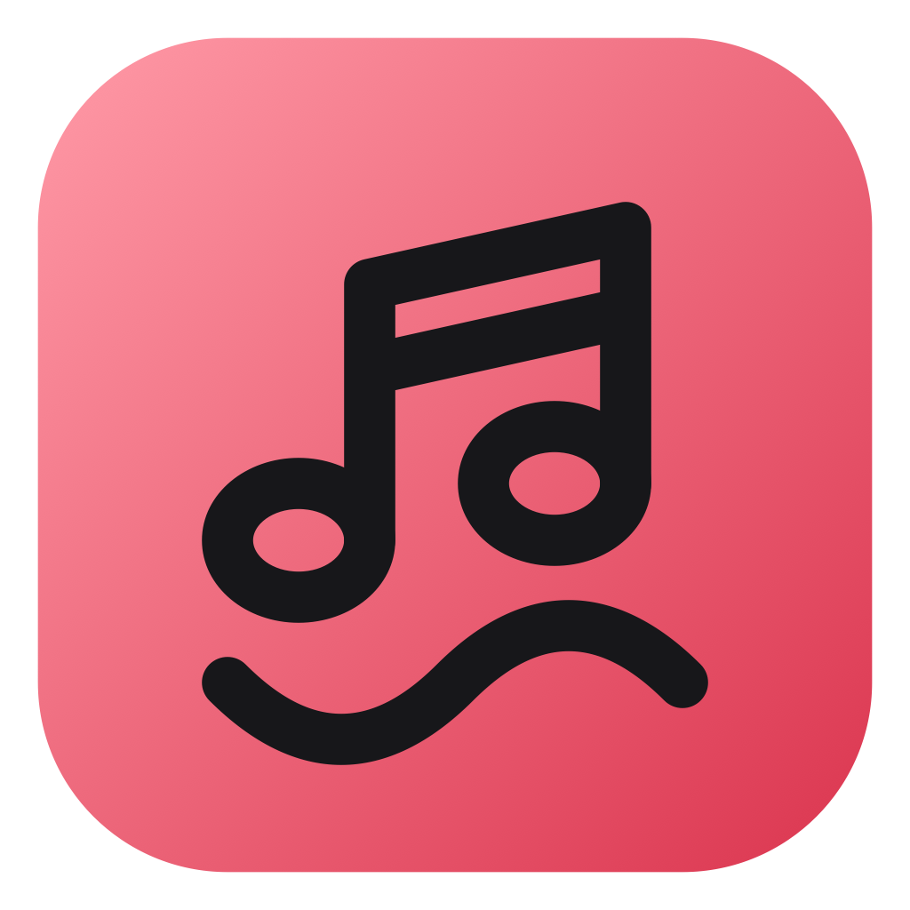
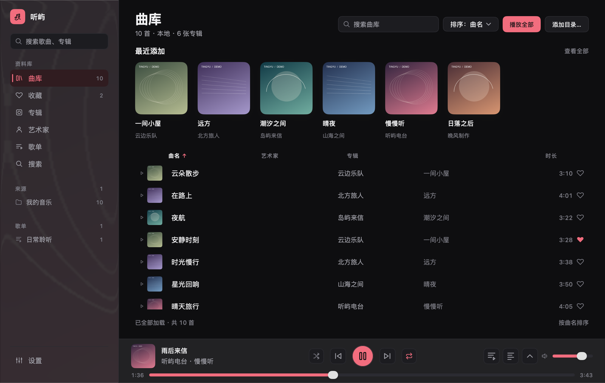
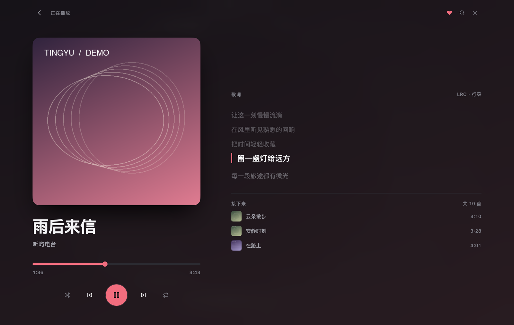

<p align="center">
  
</p>

<h1 align="center">听屿</h1>

<p align="center">
  <strong>把你的音乐，留在自己的岛屿。</strong><br />
  一款连接本地文件夹、WebDAV 和夸克网盘的 macOS 音乐播放器。
</p>

<p align="center">
  
  
  
  
</p>

<p align="center">
  <a href="#界面预览">界面预览</a> &nbsp;·&nbsp;
  <a href="#主要功能">主要功能</a> &nbsp;·&nbsp;
  <a href="#开始使用">开始使用</a> &nbsp;·&nbsp;
  <a href="#从源码构建">从源码构建</a> &nbsp;·&nbsp;
  <a href="#项目文档">项目文档</a>
</p>

<br />

<p align="center">
  
</p>

<p align="center"><sub>一个安静的空间，收藏你自己的音乐。</sub></p>

## 把音乐收在一起

音乐不必只待在一个地方。把本地文件夹和私人云盘添加到听屿，在同一个曲库中浏览、搜索和播放。

| 本地文件夹 | WebDAV | 夸克网盘 |
|:---|:---|:---|
| 选择音乐目录，扫描并整理到曲库。 | 连接坚果云、Nextcloud 等 WebDAV 存储。 | 登录后选择需要同步的文件夹。 |

## 主要功能

- **你的私人曲库**：按曲目、专辑、艺术家浏览，搜索歌曲，收藏喜欢的音乐并创建歌单。
- **专注聆听**：全屏播放界面展示封面、歌词和播放队列，背景随封面变化。
- **歌词与元数据**：从多个来源补全封面和歌词，支持手动匹配；歌词可逐行或逐字显示。
- **原生播放体验**：支持 macOS 媒体键与系统「正在播放」，关闭窗口后继续播放。
- **自己的数据**：曲库保存在本机，云盘登录凭据保存在 macOS 钥匙串。

## 界面预览

<p align="center">
  
</p>

<p align="center"><sub>正在播放 · 跟着歌词，慢慢听。</sub></p>

> 截图由当前应用界面渲染，曲目、歌词与封面均为演示内容。

## 开始使用

听屿目前面向 **macOS 12 及以上版本**，现役客户端位于 `client/`。本地文件夹、WebDAV 和夸克网盘都可以作为音乐来源。

1. 打开听屿，选择 **添加音乐来源**。
2. 选择本地文件夹，或连接你的 WebDAV / 夸克网盘。
3. 等待扫描完成，在曲库中选择一首歌开始播放。

> **获取应用**：当前尚无发布版，请从源码构建。发布后可在 [Releases](https://github.com/halunhaku/tingyu/releases) 获取。

## 从源码构建

需要 macOS 12+、Go 1.27.3 或兼容版本，以及 Xcode Command Line Tools。首次构建需要联网下载项目固定版本的 mpv / FFmpeg frameworks。

```bash
git clone https://github.com/halunhaku/tingyu.git
cd tingyu/client

./scripts/fetch-frameworks.sh
SIGN_IDENTITY=- ./scripts/bundle.sh
```

构建完成后，应用位于 `client/build/darwin-arm64/听屿.app`。上面的命令使用临时签名，适合本机开发；使用自己的签名证书时，设置 `SIGN_IDENTITY`。完整的运行、测试、签名和打包说明见 [客户端开发文档](client/README.md)。

<details>
<summary><strong>常用开发命令</strong></summary>

```bash
cd client

CGO_ENABLED=0 go build ./...
CGO_ENABLED=0 go vet ./...
CGO_ENABLED=0 go test ./...
gofmt -l .
```

</details>

## 数据与隐私

- 曲库、封面和设置默认保存在 `~/Library/Application Support/com.halunhaku.tingyu/`。
- WebDAV 密码和夸克登录凭据保存在 macOS 钥匙串。
- 项目不提供音乐资源；播放内容来自你添加的本地文件或个人云存储。
- 开发和验收时可使用 `TINGYU_DATA_DIR` 指向数据副本；数据备份、只读模式与恢复说明见 [客户端开发文档](client/README.md)。

## 项目文档

| 内容 | 入口 |
|:---|:---|
| 客户端、构建与数据目录 | [client/README.md](client/README.md) |
| 当前设计与界面实现 | [设计方向](docs/design/2026-10-26-ui-redesign-directions.md) · [UI 实现计划](docs/UI_IMPLEMENTATION_PLAN.md) |
| 架构与迁移记录 | [macOS 客户端迁移方案](docs/plan/2026-10-25-macos-mygo-migration-plan.md) · [阶段记录](docs/plan/) |
| 历史实现 | `legacy-swift/` 为冻结的 SwiftUI 参考；`docs/` 保留历史设计和迁移资料。 |

<!-- project-status:start -->

**项目状态**：候选主线 · 保留项目，按实际使用需求投入。现役客户端版本为 `0.1.0`。

**项目导航**：[全部项目与维护安排](https://github.com/halunhaku)

<!-- project-status:end -->

## 开源协议

基于 [MIT License](LICENSE) 开源。听屿不内置、不提供、不分发音乐音频资源；请使用你有权访问的内容。
