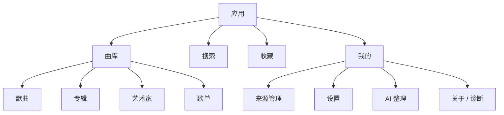
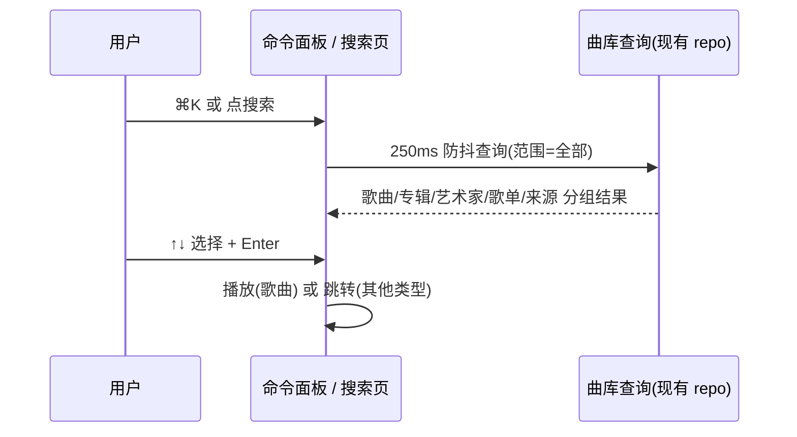

# 听屿 3.0 — 信息架构与体验重设计(Phase 2)

> 输入:`docs/UI_UX_AUDIT.md`(Phase 1 审计,问题编号 A*/V*/I*/S*/P* 在下文被引用)。
> 本文只回答「用户目标 → 信息结构 → 导航模型 → 交互语汇 → 平台差异」,具体视觉数值在 `DESIGN.md`(Phase 3)。
> 所有决策都标注了它要解决的审计问题;未映射到任何问题的设计被删除。

---

## 1. 设计目标与产品原则

产品的唯一承诺:**让你的私人音乐库成为一件被妥善安放的东西。**

由此推出五条硬性原则,后续任何设计决策不得违反:

| 原则 | 含义 | 反面(必须避免) |
|---|---|---|
| **Music-first** | 封面与文字是唯一的高饱和 / 高对比元素;界面其余部分退到低彩度底噪 | 红色渐变、玻璃拟态、卡片投影堆叠 |
| **Calm** | 首页不推销任何东西;没有推荐、没有横幅、没有"发现"广告位 | 通用 Dashboard 卡片栅格 |
| **Library-truthful** | 界面只呈现库里真实存在的内容与状态;空、错、加载必须有明确区分 | 占位卡片、假进度、"未在播放"占位条 |
| **Boring navigation** | 目的地数量克制且稳定;同一功能在任何入口都在同一位置 | 平台硬切的第二套 IA |
| **Native where it matters** | 布局由**窗口宽度**决定,交互语汇由**平台**决定(hover/右键/键盘 vs 长按/手势) | 用 `Platform.isAndroid` 决定页面结构(A2/A3) |

**一句话定位**:一个安静、编辑感强、桌面与移动各自得体的私人音乐图书馆。对标气质是 Roon 的克制、Apple Music 的排版纪律、Spotify 的播放器可靠性,但不复制任何一家的界面构成。

---

## 2. 用户目标与任务模型

从代码里真实存在的业务能力反推用户任务(仅列出实现支撑的):

| # | 用户目标 | 频率 | 现有支撑 | 现状缺口 |
|---|---|---|---|---|
| T1 | 「我想听点什么」——立刻开始播放 | 极高 | `playTracks(queue,startIndex)` | 无随机播放入口、空闲态无引导 |
| T2 | 「我要找到那一首」——定向检索 | 高 | 曲库内搜索(200 条截断) | 无全局搜索、无范围、无歌单/来源结果(I15) |
| T3 | 「按专辑/艺人整理着看」 | 高 | 专辑/艺人页 + 分组视图 | 无排序筛选、网格/列表不可切(I10) |
| T4 | 「沉浸地听这一张」 | 中高 | now-playing 路由页 | 布局像卡片详情页,不像舞台(V7) |
| T5 | 「管好我的来源」 | 中 | 本地/SAF/WebDAV/夸克 + 同步 | 同步无进度、错误无恢复路径(I11) |
| T6 | 「整理我的库」——收藏、歌单、队列 | 中 | 收藏(仅右键)、歌单 | 收藏入口缺失(I5)、队列不可编辑(I6) |
| T7 | 「让元数据更整齐」 | 低 | 补全服务、手工匹配 | 入口分散、无批量回执 |
| T8 | 「调设置 / 换主题」 | 低 | 主题三态 | 入口在移动端藏在曲库页内(I12/A1) |

**任务模型的结论**:这是一个「**浏览为主、播放为核、运维为辅**」的应用。
因此主导航只服务 T1–T4;**来源与设置是运维后台,不该和音乐内容抢一级入口**(修正现有移动端把"来源"做成同级 Tab 的问题)。

---

## 3. 信息架构

### 3.1 内容模型(来自数据层,不新增实体)

```
库 Library
├── 歌曲 Track      ── title / artist / album / duration / cover / source / addedAt / favorite
├── 专辑 Album      ── title / artist / year / cover / Σtracks / Σduration
├── 艺术家 Artist   ── name / avatar / Σalbums / Σtracks
└── 歌单 Playlist   ── name / items(有序) / cover(2×2 拼贴)
来源 Source         ── 本地目录 / SAF 目录 / WebDAV / 夸克网盘,+ 同步状态
播放域 Playback     ── queue / index / shuffle / repeat / volume / lyrics / output
```

**关键判断**:`最近添加` 不是目的地,是**歌曲的排序方式**;`收藏` 不是筛选器,是**用户自建的目的地**。
所以旧 IA 中「最近添加 / 艺术家 / 专辑」作为三个一级项(桌面)或两个突兀按钮(移动)被压缩为:**曲库 = 一个视图族 + 排序/筛选控件**。

### 3.2 导航模型

**单一结构,两种外壳。** 导航目的地集合是唯一的一份,由宽度决定用哪种外壳呈现:



| 目的地 | 桌面侧栏(expanded) | 移动/窄窗(compact) | 说明 |
|---|---|---|---|
| 曲库(歌曲/专辑/艺术家/歌单) | 分组「曲库」下四行 | Tab1「曲库」+ 分段控件 | 桌面四行各自独立(常有 4 项均可见),移动合成一页 |
| 搜索 | 侧栏顶部搜索框 + ⌘K | Tab2「搜索」 | 移动端独立 Tab 是为了单手一步到位 |
| 收藏 | 分组「曲库」下一行 | Tab3「收藏」 | 收藏含 歌曲 / 专辑 两个分段 |
| 最近添加 | 曲库组内一行 | 曲库·歌曲 的排序项 + 「最近」筛选 chip | 见上:是排序,不是目的地;桌面临时保留入口因其廉价 |
| 我的(来源/设置/AI/关于) | 侧栏底部两个入口 + 分组「来源」列表 | Tab4「我的」 | 运维后台,不与音乐内容抢位 |
| 播放舞台 / 队列 / 歌词 | 覆盖式沉浸层 + 检查器 | 全屏页面 + 底部抽屉 | 见 §5.4 |

宽窗三档(取代现有 `Platform.isAndroid` 硬切 — **A2/A3**):

| 形态 | 宽度 | 导航外壳 | 播放器形态 | 列表密度 |
|---|---|---|---|---|
| `compact` | < 640 | 底部 4 Tab | 迷你条(56) → 全屏舞台 | comfortable(行高 56) |
| `medium` | 640–1023 | NavigationRail(88) | 底部传输条(72),仅保留音量 | comfortable |
| `expanded` | ≥ 1024 | 侧栏(248,可折叠为 72 rail) | 传输条(88)+ 右检查器 | compact(行高 44/48) |

> 平台只影响:**hover/右键 有无、快捷键映射(⌘/Ctrl)、安全区与返回手势、滚动条样式、窗口标题栏内边距**。平台**不影响**页面结构。

### 3.3 路由表(落地口径)

沿用**单个 `ShellRoute`** + Riverpod 作为页面状态源(**不引入 `StatefulShellRoute`**)。页面状态归属写清楚,避免"接上 provider 就自动保活"的误解:

- 持久视图状态(排序 / 筛选 / 搜索词 / 分段 / 密度 / 主题)= provider,跨页面切换保留;
- 滚动位置 = 每个列表的 `PageStorageKey`,同一路由重建时恢复;
- 选区 / 焦点 / 输入框光标 = 页面局部状态,切根页即重置(与桌面音乐应用一致,不假装能跨页保留)。

| 路径 | 页面 | 宿主 | 备注 |
|---|---|---|---|
| `/library/songs`、`/library/albums`、`/library/artists`、`/library/playlists` | 曲库四段 | 外壳 | 默认 `/library/songs`;`?sort=&filter=` |
| `/favorites` | 收藏 | 外壳 | 歌曲 / 专辑分段 |
| `/search` | 全局搜索 | 外壳 | `?q=&scope=` |
| `/album/:name?artist=`、`/artist/:name`、`/playlist/:id`、`/source/:id` | 详情 | 外壳;compact 时外壳隐藏底部 Tab 栏(页面自带返回) | 参数用 `Uri.encodeComponent`;专辑/艺术家沿用现有聚合键(name/artist),不新增 id |
| `/sources`、`/settings`、`/settings/:section`、`/ai` | 运维页 | 外壳 | |
| `/stage` | 全窗播放舞台 | **根 Navigator** | Esc / 下拉关闭;`?tab=lyrics｜queue`;无历史深链时回退 `/library/songs` |
| `/queue`、`/lyrics` | 移动端独立页 | **根 Navigator** | 桌面用检查器宿主同一组件 |
| `/onboarding` | 首次引导 | **根 Navigator** | 仅「库加载成功 ∧ 无来源 ∧ 无曲目」进入 |

导航语义:根级目的地之间用 `go`(不压栈、可反复横切);详情用 `push`(有返回栈、可 pop 回列表);`/stage`、`/queue`、`/lyrics` 用 `push` 到根 Navigator,保证盖住外壳与播放条。外壳读 `matchedLocation` 决定是否隐藏底部导航,不需要双外壳。

旧路径 `/`、`/now-playing`、`/playlists`、`/artists`、`/albums`、`/library`、`/recent` 全部迁移,不保留别名。迁移必须同时改到:`lib/app/router.dart`、macOS 菜单(`lib/main.dart` 的 10 个带快捷键菜单项)、`TINGYU_DEBUG_ROUTE` 取值、`test/navigation_gesture_test.dart` 与所有 `push`/`go` 调用点。

---

## 4. 核心用户路径

### 4.1 起播(T1)——最重要的一条路径,必须在 1 次点击内完成

| 入口 | 行为 |
|---|---|
| 行点击(任意列表) | 立即播放该行,队列 = 当前可见列表(含排序/筛选后的顺序) |
| 行 hover 播放键(桌面) | 同上,且不改变多选 |
| 详情页「播放」主按钮 | 队列 = 该专辑/歌单全量,从第 1 首(或随机)开始 |
| 搜索最佳命中 + Enter | 播放该曲目 |
| 空闲态「播放随机 50 首」 | 建立随机队列并进入播放 |
| 双击表格行(桌面) | 播放(与单击等价;表格里单击=选中) |

**队列语义(必须写进代码注释,避免 Phase 4 期间误改)**:任何起播都以「当时可见集合 + 排序」为队列快照。队列**只支持读、跳转与末尾追加**:引擎只有 `setQueue`(重建播放列表,会打断当前播放)与 `addToQueue`(末尾追加,不打断),没有插入/移除/重排接口,且 `lib/playback/**` 契约冻结。因此队列面板不做「下一首播放 / 移除 / 重排 / 清空」——不提供点了会中断播放或只是摆设的控件。

### 4.2 定向检索(T2)



规则:
- 结果分组固定顺序:歌曲 → 专辑 → 艺术家 → 歌单 → 来源;每组最多 5 条,页内「查看全部 →」切到对应范围。
- 命中子串以强调色浅底高亮(中英文均按原始子串匹配,不做大小写外的不必要归一化)。
- 截断(超出查询上限)时给出**可操作**提示:「显示前 N 条 · 继续输入缩小范围」,并允许「查看全部 N 条」(分页加载,不再静默截断 — **I15**)。
- 移动端:进入搜索 Tab 自动聚焦、显示最近搜索(内存 ≤ 10 条,不落库)、范围用 chips。

### 4.3 浏览与整理(T3/T6)

- 排序/筛选是**曲库级别的持久化视图状态**(Riverpod,按窗口会话保留):排序项 `标题/艺术家/专辑/添加时间/时长`;筛选 chips `全部 · 最近添加 · 已收藏`。
- 桌面歌曲列表 = **真表格**:列头可点排序、行可 `Ctrl/⌘` 多选、`Shift` 区间选择、多选后出现浮动批量栏(播放 / 加入队列 / 加入歌单 / 收藏)。替换 legacy 有、Flutter 版丢失的能力(**I4**)。
  **权限边界**:「从库中移除」不做——库记录由扫描事实决定,单删一行会在下次扫描复活,删歌单引用或实体文件则破坏用户数据(见 §10.3);歌单页内的「移出歌单」是成员关系操作,与库无关,保留。
- 单击 = 选中,双击 = 播放;多选时单击为加选(**这条与 Web 一致,降低学习成本**)。
- 长按 / 右键 = 同一个上下文菜单组件:播放 / 添加到队列(末尾) / 添加到歌单 ▸ / 收藏 / 在专辑中查看 / 在艺人中查看 / 重新匹配元数据。覆盖专辑、艺人、歌单、队列行(**I3**)。歌单页内额外提供「移出歌单」。
- 收藏入口锚定在**所有**曲目行与三个播放器形态上(**I5**)。

### 4.4 沉浸聆听(T4)

- 桌面 `expanded`:**传输条常驻** + **检查器**(右侧 320–380px,可切换 队列 / 歌词,`⌘U` `⌘L`),浏览不中断;
- 桌面点封面/标题或 `⌘⇧P` → **`/stage` 全窗舞台**(覆盖侧栏),两栏:封面 + 控制 / 歌词或队列;`Esc` 返回。
- 移动:迷你条点击 → 舞台**共享元素展开**(封面 Hero 从迷你条 40px 到舞台封面,320ms);舞台内上滑显示歌词、右滑切换队列;下拉收起回迷你条。
- 舞台是**产品设计质量的上限所在**:封面上限尺寸、留白比例、排版层级、动态取色都按 `DESIGN.md` 的最高标准执行。

### 4.5 来源运维(T5)与首次使用(T8')

- 来源列表行的状态语汇必须完整:**未登录 / 已连接 · N 首 · 上次同步 x 分钟前 / 同步中(进度条 + 计数) / 失败(原因 + 重试)**。
- 同步结果给**回执**,字段严格来自现有 `SourceScanResult`(`app/lib/sources/source_adapter.dart:5-27`):新增 x、更新 y、跳过 z(`skipped`)、以及 `cancelled` / `truncated` + `truncationReason` 的显式提示(例:「本次未覆盖全部内容:目录层级超限」,并说明此时不会删除旧曲目——对应 `isAuthoritative` 语义)。
- **不做逐文件失败明细**:现有适配器契约只有 `skipped` 计数,没有失败条目列表;补齐需要改动 `SourceAdapter`/各适配器,超出本次范围(列入 §10 非目标)。诊断信息继续走现有日志。
- 扫描/同步必须可取消,取消后如实呈现「已取消」而不是"完成"。
- 添加来源:表单必须逐字段校验(`errorText`)、提供「测试连接」、失败不得静默(**I11**)。
- 空库(无来源)不再提示"去设置里添加",而是进入 `/onboarding`:选来源类型 → 表单 → 扫描(实时计数) → 完成(「已添加 N 首」+「随机播一首」)。

---

## 5. 页面规格(Phase 4/5 的实现契约)

每个页面给出:**结构 → 组件 → 状态**。组件名对应 `DESIGN.md` §6 的组件清单。

### 5.1 曲库 · 歌曲
- 页头:`PageHeader`(标题「歌曲」+ 计数副标题) + `ViewToolbar`(排序菜单、筛选 chips、视图切换、搜索框)。
- 主体:`TrackTable`(桌面) / `TrackList`(compact)。列:`#`(播放中→音符/暂停)、标题(封面 40 + 曲名 + 艺术家)、专辑、时长(等宽数字)、收藏、更多。
- 空态:`EmptyState`(有来源→「还没有歌曲」+「同步来源」;无来源→引导到 onboarding)。
- 加载:12 行骨架;错误:`ErrorState` + 重试。

### 5.2 曲库 · 专辑 / 艺术家 / 歌单
- 网格列数按宽度自适应(min 168/140),不使用固定 8 列(**A2**)。
- 专辑卡:封面(圆角 12 + 1px 描边) + 标题(bodyM,1 行) + 艺术家(bodyS);hover 显示播放键 + 二级操作键;点击进详情。
- 艺术家:列表(头像 44 + 名称 + 「N 张专辑 · M 首」+ chevron),理由=可扫读性优于网格。
- 歌单卡:2×2 封面拼贴 + 名称 + 计数;`+ 新建歌单` 是首个网格项(不是 AppBar 按钮)。

### 5.3 专辑 / 艺术家 / 歌单详情
- `DetailHero`:封面 220(compact 160)+ 标题(displayM 32)+ 艺术家/元数据行(年份 · N 首 · 总时长 · 来源 chip)+ 动作行(`播放` 强调胶囊 / `随机` / `收藏` / `更多`)。
- 曲目区:`SectionHeader` + `TrackTable/TrackList`;滚动时 `SliverAppBar` 吸附为「迷你封面 + 标题 + 主播放键」。
- 艺术家页:分区 `专辑`(网格)+ `全部曲目`(默认展示 10 首,「全部展开」)。
- 歌单页额外:`重命名/删除` 在 `更多` 菜单内,删除需确认;支持拖拽重排(`ReorderableListView`,现有能力保留)。

### 5.4 播放器(三形态,同一状态源)
| 形态 | 内容 | 备注 |
|---|---|---|
| `TransportBar`(medium/expanded) | 左:封面 56 + 标题/艺术家(点击进舞台) + 收藏;中:传输键 + 进度(可拖,带缓冲);右:歌词/队列开关 + 音量 + 全屏 | **队列为空时整条收起**(200ms),不留"未在播放"占位(**V9**) |
| `MiniPlayer`(compact) | 封面 40 + 标题/艺术家 + 收藏 + 播放/暂停 + 下一首;顶部 2px 进度线 | 点击→舞台(Hero);长按→快捷菜单;收藏为常驻图标(触摸目标 44) |
| `PlayerStage` | 封面 → 标题(displayL/displayM) → 艺术家 → 专辑 → 进度 + 时间 → 传输键(上一/播放/下一为 56px 主控) → 次级(随机/重复/收藏/歌词/队列/音量) | 背景由封面动态取色生成柔和渐变;**无卡片阴影**(**V7**) |

舞台的歌词区(`LyricsPanel` 重做):支持**点击跳转**、当前行强调(强调色 + 轻微放大)、手动滚动 3 秒内不强制回拉、无 LRC 时显示纯文本并可开关、保留现有「抓取歌词」入口。有逐行时间戳才做行高亮;逐字时间戳现有数据不提供,不做逐字高亮(**I7 的数据边界**)。
队列区(`QueuePanel` 重做):`正在播放` / `接下来` 两段;点击任意行跳转(现有 `playAt`);显示收藏态;支持「加入队列」后的末尾追加结果实时刷新(**I6/I5**)。不做拖拽重排/移除/清空(见 §4.1 队列语义)。

### 5.5 搜索
段:`全部 / 歌曲 / 专辑 / 艺术家 / 歌单`(来源不进搜索:数量少且就在「我的」里)。
主体为分组结果列表(复用 `TrackRow`/`AlbumCard`)。数据来自**只读新增查询**(曲目/专辑/艺术家/歌单各一条 `LIKE` 查询,稳定排序 + 分页游标);不显示未经计算的「共 N 条」——要么真实 `COUNT(*)`,要么不显示总数。现有 `watchSearch`(200 条上限、仅曲目)仅供旧调用方,不用于新搜索页。
状态:未输入(最近搜索 + 提示)、加载(骨架)、无结果(`EmptyState` + 「清除筛选」)、错误(重试)。防抖统一 250ms。

### 5.6 来源与设置
- `/sources`:来源卡片列表(类型徽标、名称、状态行、右对齐主操作 `同步`)+ 底部「添加来源」主按钮。
- `/source/:id`:页头(名称/状态/编辑/移除)+ 曲目列表(同一 `TrackList`)。
- `/settings`:分组卡片(外观 / 播放 / 音乐库 / 来源 / AI / 关于),行 = 标签 + 说明 + 控件(Row 56px);危险操作(清洗库/重建索引)用危险色 + 确认对话框。
  **新增能力提示**:现状 `themeMode` 硬编码为跟随系统、密度由平台推导、设置页只有统计/维护入口(审计 §3.5),因此「外观(主题模式 / 密度 / 封面动态取色)」与「播放(试听行为、音量)」开关属于**本次新增**,需要一个极简偏好存储(`lib/data/settings_store.dart`,JSON,原子写,坏文件回退默认值且不影响 `library.sqlite`)。
  **首次引导触发条件**:仅当「数据库加载成功 ∧ 来源数 = 0 ∧ 曲目数 = 0」时进入 `/onboarding`;有来源但零曲目(离线/未同步/权限失效)显示来源恢复态,而不是当成新用户。
- `/ai`:保留现有能力(接口配置 + 与清洗流程的连接),但错误/加载改为标准 `ErrorState`/骨架(**V10**)。

### 5.7 状态系统(全局)
统一 `AsyncStateView<T>`:`loading → 骨架`、`error → ErrorState(title, detail, retry)`、`empty → EmptyState(icon, title, description, action)`、`data → builder`。
禁止裸 `CircularProgressIndicator` 与裸错误 `Text`(审计 V10);禁止在 UI 内出现 `Colors.green/red/white` 等硬编码(**V11**)。

---

## 6. 交互语汇

| 能力 | 桌面(medium/expanded) | 移动(compact) |
|---|---|---|
| hover | 行/卡片/tab 三态(默认/悬停/按下),操作键**仅悬停出现** | 无 hover,操作键常驻或长按面板 |
| 右键 | 全量上下文菜单(列表、网格、队列、侧栏) | 长按 = 同一菜单(bottom sheet 形态) |
| 键盘 | `Space` 播放/暂停 · `⌘←/→` 上/下一首 · `⇧⌘←/→` ±10s · `⌘↑/↓` 音量 · `⌘K` 命令面板 · `⌘F` 搜索 · `⌘L/⌘U` 歌词/队列 · `⌘1..4` 导航 · `Esc` 关闭层 · `⌘,` 设置 · `⌘N` 新建歌单 · 表格内 `⌘A`/`Shift`/方向键/`Enter` | 无(系统级返回/下拉) |
| 滚动条 | 桌面常显细滚动条(8px,hover 变宽) | 无 |
| 手势 | 无 | 舞台下拉收起、上滑歌词、队列横滑切换、列表行侧滑(加入队列/收藏) |
| 窗口 | 软下限 360×480:更窄时显示居中提示页(`TyErrorView` 语义:窗口过小 + 当前尺寸),不崩版(**I13**);不申请原生最小尺寸(需窗口管理依赖) | 安全区 + 手势区避让 + 底部导航避让 |
| 选定态 | 键盘焦点环 2px 强调色 + 2px 偏移,全链路可达(**S4**) | 按下态 + 触感反馈(保留现有 haptics) |

**语汇一致性规则**:同一动作在所有宿主使用同一菜单项文本与同一图标;图标语义不得复用(例:♥=收藏,⊞=队列,❝=歌词)。

---

## 7. 动效系统(规格摘要,数值见 DESIGN.md §7)

命名过渡(每个都必须有明确目的,无目的动效一律不做):

| 名称 | 用途 | 时长/曲线 |
|---|---|---|
| `fadeThrough` | 切换曲库分段(歌曲↔专辑) | 200ms / decelerate + 内容 60ms 淡出 |
| `stageExpand` | 迷你条/传输条 → 舞台(封面 Hero + 背景渐显 + 内容位移 16px) | 320ms / standard |
| `stageCollapse` | 舞台 → 迷你条(下拉手势跟随 + 阈值 35%) | 跟随 + 240ms |
| `coverCrossfade` | 换曲时封面交叉淡入 | 180ms |
| `ambientDrift` | 舞台背景极缓漂移 | 24s 循环,`disableAnimations` 时静止 |
| `listStagger` | 列表首次呈现,前 6 项 20ms 递增 | 200ms |
| `lyricFocus` | 当前歌词行强调 | 240ms |
| `barCollapse` | 队列为空时传输条收起 | 200ms |
| `pressFeedback` | 控件按下(scale 0.97 / overlay 8%) | 120ms |

**全局约束**:`MediaQuery.disableAnimationsOf(context)` 为真时,除"必要的空间切换"外全部瞬时完成(**S5**);列表滚动中禁止触发动画;所有动画必须在 60fps 下不引起整页重建(**P3** 的测试必须继续通过)。

---

## 8. 无障碍与响应式硬化

- 触控目标:compact ≥ 44×44,medium/expanded ≥ 28×28(指针),传输键 ≥ 48。
- 对比度:正文 ≥ 4.5:1,大字/图标 ≥ 3:1;强调色在浅/深底分别取值(`DESIGN.md` §2 给出 token 与实测比值)。
- 每个纯图标控件必须 `tooltip` + `Semantics(label)`;进度条暴露 `SemanticsValue`;行暴露「曲名 · 艺术家 · 时长 · 播放中」。
- 焦点顺序 = 视觉顺序;模态层必须聚焦陷阱 + `Esc` 关闭;命令面板全键盘可用。
- 文案:中英混排不留半角空格歧义、不用缩写("N 首"而非"N tracks");所有空/错/加载态有一句可执行的中文行动指令。
- 长标题/缺失封面:标题 1 行省略 + tooltip 全文;无封面用确定性占位(基于 id 的柔和色块 + 音符),**不使用随机色**。

---

## 9. 审计问题 → 设计回应(可追溯性)

| 审计问题 | 回应 | 落点 |
|---|---|---|
| A1 无语义 token / 红种子污染中性色 | 建立语义 token 层,强调色与中性色解耦 | DESIGN.md §2 |
| A2 平台硬切 / 8 列网格 | 宽度三档 `compact/medium/expanded`;网格按宽度自适应 | §3.2 / §5.2 |
| A3 三套平台判断口径 | 唯一 `FormFactor` provider(宽度)+ `PlatformTraits`(交互) | §3.2 / §6 |
| A4 重复组件 | 统一组件清单,重复实现删除 | DESIGN.md §6 |
| A5 常量散落 | spacing/radius/icon/type token | DESIGN.md §3–5 |
| A6 播放页被 push 进 ShellRoute | `/stage` 独立于外壳;队列/歌词为可复用面板 | §3.3 / §5.4 |
| A7 无 UI 测试脚手架 | Phase 4 先建 `test/support/`(pump、fake engine、尺寸矩阵) | DESIGN.md §9 |
| V1 中性色发粉 | 冷中性灰阶 | DESIGN.md §2 |
| V2 深色层级不足 | 深色用亮度分层 + 描边替代阴影 | DESIGN.md §2 |
| V3 强调色非品牌红 | 品牌红作为唯一强调色,双主题分别校验对比度 | DESIGN.md §2 |
| V4 排版层级塌缩 | 11 级 Type Scale(display→overline),禁用 bodySmall 万能化 | DESIGN.md §4 |
| V5 字体族未指定 | 平台字体栈 + CJK/Latin 回退链 + `letterSpacing:0` | DESIGN.md §4 |
| V6 列表密度失衡 / 无列头 | 真表格 + 列头排序 + 可选列 + hover/选中行 | §5.1 / §4.3 |
| V7 播放器像卡片 | 舞台化:封面无阴影、字号上限、控制键比例 64px 主控 | §5.4 |
| V8 侧栏选中态弱 | 侧栏选中 = 强调色左标 + 强调色文字 + 8% 强调底色 | DESIGN.md §6 |
| V9 播放条语言不统一 | 单传输条语义,空闲收起 | §5.4 |
| V10 加载/空/错不统一 | `AsyncStateView` + 骨架 + `ErrorState` | §5.7 |
| V11 硬编码颜色 | 禁止;全部走 token(测试可扫描) | DESIGN.md §2.5 |
| I1 无 hover | 行/卡片/tab 三态语汇 | §6 |
| I2 无快捷键 + 搜索吞空格 | 全量快捷键表 + 输入态吞键修复 | §6 |
| I3 右键菜单覆盖不足 | 统一上下文菜单组件 + 完整菜单项 | §4.3 |
| I4 无多选 | 表格多选 + 批量栏 | §4.3 |
| I5 收藏入口缺失 | 行/三形态播放器/队列全部接入 | §4.3 / §5.4 |
| I6 队列不可编辑 | 队列面板显示当前曲与后续顺序、点击跳转、末尾追加;不提供移除/重排(引擎重建会打断播放,§4.1) | §5.4 |
| I7 歌词不可跳转 | tap-to-seek + 手动滚动尊重 + 行强调(逐字高亮受数据限制) | §5.4 |
| I8 播放失败仅有全局 SnackBar | 行内/条内/舞台渲染持久错误态 + 重试;SnackBar 保留为即时提示 | §5.4 / DESIGN.md §6 |
| I9 buffered 未用 | 进度条绘制缓冲段 | §5.4 |
| I10 无排序/筛选/视图 | 视图状态持久化 + 网格/表格切换 | §4.3 / §5.1 |
| I11 危险操作确认缺失 | 统一确认对话框 + 表单校验 + 测试连接 | §4.5 / §5.6 |
| I12 移动端设置入口隐蔽 | 「我的」Tab 承载运维 | §3.2 |
| I13 无最小窗口保护 | 软下限 360×480 + 低于阈值提示 | §6 |
| I14 无刷新 | 列表刷新动作(明细列表 `invalidate`)+ 来源手动同步(区分语义,防并发) | §5.6 |
| I15 移动端无最近添加入口 | 曲库·歌曲的「最近添加」筛选 + 按添加时间排序 | §3.2 / §5.1 |
| S1–S4 无障碍缺口 | §8 全部落实 | §8 |
| P1 背景过绘制 | 舞台背景 = 单张渐变 + 低频重绘,禁止每帧多渐变圆 | DESIGN.md §7 |
| P2 列表无 itemExtent | 表格/列表固定行高 + `itemExtent` | DESIGN.md §5 |

---

## 10. 非目标(明确不做,避免范围膨胀)

1. 不做推荐、社交、评论、在线曲库、歌词投稿等联网内容功能。
2. 不引入大型依赖(不引入动画库、UI 组件库、`window_manager`、字体文件)。
3. 不改数据层/schema/同步协议/播放内核;`TrackRepository`、`SourceAdapter`、`TingyuAudioHandler`、`TrackResolver` 与 `lib/playback/**` 各引擎的对外契约保持不变。允许的**三类新增**(均为纯增量、有回归测试约束):
   - 应用偏好存储(主题模式/密度/取色开关,JSON 文件,不读写业务数据);
   - `lib/app/playback_controller.dart` 上的**一个**新增方法:`enqueueTracks(List<Track>)`(末尾追加,匹配引擎 `addToQueue` 的不打断语义)。必须遵守既有不变量:先等在飞的 `_prefetchFuture` 落地、`_sourceQueue`/`_queue`/`_trackIds`/`_resolvedSourceIndices` 四份平行数组同步追加、`_nextSourceIndex` 与 `_passFinished` 不被破坏。**不做**插入/移除/重排/清空(引擎无对应能力,重建会打断播放);
   - 仓库上的**只读新增查询**(搜索分组、总数、按添加时间分页):不改既有方法签名与行为,不改 schema;`watchSearch` 保持原样。
4. 不做「从库中移除」:无持久排除语义时,单删记录会在下次扫描复活,删文件则破坏用户资产;歌单「移出歌单」不受影响。
5. 不做主题编辑器(保留 跟随系统/浅色/深色 三态 + 密度开关)。
6. 不做多窗口、不做迷你窗(macOS PiP 已知值为 0)。
7. 不做逐文件同步失败明细(需扩展 `SourceAdapter` 结果契约,超出本次范围);同步反馈限定在现有 `SourceScanResult` 可表达的范围内。
8. 不保留旧路由别名与旧组件副本(干净切换)。

---

## 11. 平台差异汇总表(交付核对用)

| 维度 | macOS | Windows / Linux | Android / iOS |
|---|---|---|---|
| 外壳 | expanded 侧栏(+medium rail) | 同 | compact 底部 4 Tab |
| 窗口 | 软下限 360×480;标题栏留白适配 | 同 | — |
| 快捷键 | ⌘ 系全量 | Ctrl 系全量 | 无 |
| 右键 | 上下文菜单 | 上下文菜单 | 长按 → bottom sheet |
| hover | 全量 | 全量 | 无 |
| 播放器 | 传输条 + 舞台 + 检查器 | 同 | 迷你条 + 舞台(下拉收起) |
| 手势 | 无 | 无 | 下拉收起/上滑歌词/横滑切换/侧滑行操作 |
| 安全区 | — | — | `SafeArea` + 手势条避让 + 导航条避让 |
| 滚动条 | 常显 8px | 常显 8px | 隐藏 |
| 状态栏/系统媒体 | Windows SMTC 由 `audio_service_win` 提供;UI 只**只读展示**当前后端名(诊断),不伪造输出设备切换 | 同 | 系统媒体通知(已有) |

---

## 12. 验收口径(Phase 2 → 6 的验收条件)

Phase 4/5 的实现必须同时满足:

1. **可运行**:Windows 上 `flutter run -d windows` 能启动,浅/深主题各截 1440×900 与 1280×720,移动形态截 412×915。
2. **可追溯**:`DESIGN.md` §6 组件清单中的每个组件都在代码中存在且被实际使用;`AsyncStateView` 覆盖所有异步页面。
3. **无回归**:`flutter test` 全绿(允许按新 UI 重写 UI 断言,禁止降低覆盖强度,禁止删除业务断言)。
4. **业务不变**:业务/数据层对外契约(§10.3)不变;播放、队列、歌词、收藏、来源同步、元数据、AI 清洗功能逐项手工回归。
5. **平台得体**:§11 每一行都有可见证据(截图或交互记录)。
6. **状态完备**:每页可演示 加载/空/错/数据 四态;长标题、缺封面、超长歌单、网络失败四种边界可复现。
7. **设计系统可用**:新增一个页面的成本 = 组合组件 + token,不需要新增魔法常量。

---

## 13. 下一步

Phase 3 产出 `DESIGN.md`(可执行设计系统:token 具体值、组件规格与状态表、响应式规则、动效曲线、无障碍数值、实现约定)。随后由 GPT 规划 Agent 基于本文件与 `DESIGN.md` 产出 `docs/UI_IMPLEMENTATION_PLAN.md`(文件级改动清单、迁移顺序、测试策略、验收条件),再进入 Phase 4 编码。
