# 听屿 UI 重设计：三个方向与规格

> 交付日期：2026-10-26　状态：方向提案（未实施，不改 `client/` 行为代码）
> 渲染：`client/tools/designpreview`，`ui.Render` 离屏 1200×760 DIP @2×
> 数据：本机真实曲库的只读副本（201 首、夸克网盘来源、190 个封面），不是虚构内容
> 图：`docs/screenshots/design/{a,b,c}/{library,stage,sources,settings}-{light,dark}.png`（下文逐页内嵌，另有 `docs/design/index.html` 可左右对比）
> 令牌：`docs/design/2026-10-26-ui-redesign-tokens.json`（与本文表格同源，由渲染器导出）

---

## 0. 结论

**推荐方向 A（声档 1.5「静室」）**，并在实施后把 B 的舞台形态作为 A 的第 2 步（同一个应用内的「舞台模式」），C 只在曲库规模进入数千首后再考虑。

理由不是"A 更保守"，而是三条可验证的账：

1. **A 是唯一不牺牲现有能力的方案**：12 个内容页 + 舞台、8 组快捷键、列表/表格的键盘可达性、右键菜单、来源二维码流程，全部落在同一套外壳与路由里。
2. **A 的改动面最小、收益最大**：现有界面的具体短板（列宽无节奏、侧栏无分组、传输条两端拉满、舞台歌词药丸高亮、设置页第二列导航挤占宽度、页脚开发口径）全部在令牌 + 外壳 + 表格 + 4 个页面内解决，不动数据层与播放内核。
3. **B 的价值集中在舞台，而不在导航**：B 去掉常驻侧栏后，12 个页面要重新找入口，收益（沉浸感）只在舞台页；C 把行高压到 36 px、正文压到 12–13 px，用可达性换密度，而当前 201 首的曲库并不需要这个密度。

实施顺序建议：A 令牌 → A 外壳与曲库 → A 舞台 → （观察一周后）B 的舞台形态。每一步都可单独验收、可回退。

---

## 1. 证据、方法与与 Spec 的三处校正

### 1.1 这些图是什么，不是什么

- 24 张 PNG 由 `client/tools/designpreview` 用 `ui.Render` 离屏渲染：与窗口同一条构建/绘制路径，2× 输出，所以图上每一个圆角、字距、玻璃模糊、取色背景都是**同一套 MyGo 原语画出来的**，不是生成的位图，也不是修图稿。
- 数据来自本机真实库（只读打开 `library.Open`，不写、不复制），所以封面、曲名、专辑、歌词都是真实内容；"正在播放"固定在《Epiphany · BTS》第 1:06，是为了让舞台同时展示已唱/在唱/未唱三段歌词。
- 图中的页面不是最终实现：没有交互、没有动画录制。动效以本文 §4.5/§5.5/§6.5 的参数为准。

### 1.2 与 Spec 冲突、以代码为准的三处

| Spec 说法 | 代码事实（本分支 MyGo `v0.6.5-0.20261025230045-be164835449b`） | 本文的处理 |
|---|---|---|
| "MyGo 无 Hero 共享元素" | `ui.ElementTransition.Match` 就是 matched geometry（`ui/transition.go:44-50`），M4 的封面过渡已经在用（`client/internal/ui/components/cover.go:17`） | "列表到播放"按**同路径共享元素**设计，不需要额外能力 |
| 参考报告"§10"是界面做法 | 报告 §10 是"可执行清单"；界面做法在 §3.4 淡入淡出、§3.7 逐字歌词、§3.8 取色、§3.10 封面淡入、§3.11 刘海播放器 | 按实际章节引用 |
| 材质/模糊为设计原则之一 | MyGo 自带 `plugins/glass`（同模块、非第三方）：`glass.Glass`（透光+色调+边缘高光）与 `glass.Blur` 在软件光栅与 GPU 两条路径都能画 | 三个方向都给出材质规格；但有一个实测约束（见下） |

**玻璃的实测约束**（本机渲染 5 块 76×200 玻璃取样）：`glass.Glass{Style: Regular}` 在深色主题下会把 `#0E0E10` 的整体抬到约 `#555556`，与 tint 的 alpha 关系不大；`Style: Clear` 才能保持表面本身的色调（取样 `#222224`）。因此规格里区分两种材质：

- **与内容同层的长条表面**（侧栏、工具栏）用 `Clear + Tint(玻璃色 @ 0.56–0.74) + 1 px 边框`，避免"侧栏比内容还亮"。
- **需要"抬起"的表面**（B 的卡片、浮动传输条、弹层）用 `Regular`：它的提亮正是高程线索——但深色下会把卡片抬到约 `#3A3A3A`，所以只用在有意抬起的表面上，A/C 的卡片改用实底 `SurfaceRaised`。
- **小浮层**要的是把滚动内容糊掉，`Regular` 的模糊半径按表面尺寸取 0.25–0.3 的 clarity。

这条不是设计偏好，是渲染器行为（A 侧栏、B 卡片、C 侧栏三种取样分别落在 `#2D2A2C`、`#3A3A3A`、`#1A1A1C` 附近）；写进规格是为了实施时不再踩一次。

### 1.3 不做什么

- 不改 `client/internal/**` 的任何行为：本分支只新增 `client/tools/designpreview/**` 与 `docs/**`。
- 不合并 main、不打 tag、不复制 AGPL 代码（参考仓库只借做法与参数，见 §7）。
- 不做真机动画录制、不接第三方组件库、不依赖系统私有 API（刘海播放器若做，需要自建 NSPanel，列为额外能力，不在本次范围）。

---

## 2. 现状：具体问题（以当前渲染图为准）

对照 `docs/screenshots/m4-library-light.png`、`m4-stage-light.png`、`m4-sources-light.png`、`m4-settings-light.png` 与 `m5-after-*.png`：

1. **表格列宽没有节奏**：曲名列 `Grow(1)` 吃掉全部剩余宽度，曲名到艺术家之间出现 300–500 px 的空白，右侧时长又贴到边缘；表头 11 px 与行内 15 px 之间没有字号/字重关系（`client/internal/ui/components/table.go`）。
2. **侧栏是"一列同级条目"**：6 个目的地 + 来源 + 歌单 + 设置全部 44 px 行高、同样字重；没有分组标题，没有计数，空歌单只留一句"尚未创建播放列表"（`client/internal/shell/shell.go:223-320`）。
3. **传输条两端拉满**：左侧"未在播放"占位，中间控件不在窗口中心，右侧"音量"文字标签占用宽度；传输条 88 px 但内部控件 28–40 px，密度不匹配（`components/transport.go`）。
4. **舞台的强调色用错**：当前歌词高亮是浅红药丸底（`Background(Selected)`），字号只差 2 px；背景是令牌中性渐变，取色在多数浅色封面上几乎看不出来（`pages/stage.go:38-45`）。
5. **来源页把说明当内容**：一个来源 + 三张"功能说明"卡片，卡片里是给开发看的句子；有 1 个来源时页面 2/3 是空白（`pages/sources.go`）。
6. **设置页结构浪费宽度**：第二列 208 px 导航 + 内容最大 760 px，右侧 200 px 空白；说明文字是开发口径（"颜色与密度来自 Flutter 版同一套令牌""取色算法本身属于 M5 图片管线"），与用户无关（`pages/settings.go`）。
7. **开发信息进了界面**：页脚 `…/library.sqlite · 分页与聚合来自 SQL (LIMIT/OFFSET)`（`pages/library.go` 的 `Pager` 调用处）。
8. **没有材质层次**：所有表面不透明；侧栏、传输条、弹层、舞台背板之间只有 1 px 边框区分。
9. **字号阶梯只有三档在用**：正文 13/15、标题 26、表头 11；没有 overline、没有 tabular 数字（时长列在字体里是比例数字，换曲时时长会轻微跳动）。
10. **状态缺少正形**：加载态是转圈 + "正在加载…"，空态是图标 + 两行字，错误态是一行红字；三者没有统一的高度、留白与操作位。

这些就是本文每个方向要逐条回答的问题；§10 给出 A 的逐条对照。

---

## 3. 三个方向总览

| | A · 声档 1.5「静室」 | B · 舞台「潮汐」 | C · 控制台「灰阶」 |
|---|---|---|---|
| 一句话 | 把现有声档做对：纸张中性、单一朱红、排版纪律 | 封面是唯一的高饱和，其余退成光与玻璃 | 一台专业播放器：表格密度、等宽数字、检查器 |
| 目标情绪 | 安静、专注 | 鲜活、有舞台感 | 精密、克制、掌控 |
| 主要使用场景 | 201 首私人曲库的日常浏览 + 听整张专辑 | 想"看"一张唱片、歌词跟唱 | 大曲库检索、核对来源与技术信息 |
| 导航 | 常驻侧栏 236 px（保留现有 IA） | 玻璃顶栏 5 个目的 + 设置 | 侧栏 208 px + 工具栏 + 右侧检查器 |
| 行高/密度 | 44 px / 正文 14 | 网格卡片 180 + 文本 / 正文 15 | 36 px / 正文 13 |
| 强调色 | 朱红 `#B01B2E` / `#F26D7E` | 玫红 `#C92B54` / `#FF6E8A` | 琥珀 `#8A5307` / `#E3B56B` |
| 材质 | 侧栏/传输条 Clear 玻璃 | 顶栏、浮动条、卡片都玻璃 + 封面氛围 | 仅侧栏/工具栏 Clear，其余实底 |
| 动态 | 中：弹簧 0.34 s、共享封面 | 大：背景 700 ms 交叉淡入、逐字、横甩 | 小：0.10–0.22 s，几乎无回弹 |
| 最大风险 | 改动看起来"不够新" | 导航重排 + 背景对比度 | 36 px 行高与 10–11 px 字的可达性 |

三者的**信息架构不同**，不只是配色不同：A 保留侧栏与表格；B 去掉侧栏，曲库是封面网格，舞台全幅；C 增加右侧检查器，舞台变成三段式（封面/歌词/队列）。

---

## 4. 方向 A · 声档 1.5「静室」

### 4.1 定位与情绪

**定位**：现有"声档"的修正版。保留纸张中性底与朱红强调，把字号阶梯、列宽节奏、材质层次和空/错状态补齐。
**情绪**：安静、专注，像一间整理过的私人书房；封面是唯一有图片质感的东西。

### 4.2 令牌

#### 颜色

| 角色 | 浅色 | 深色 | 用途 |
|---|---|---|---|
| Canvas | `#F4F4F1` | `#0E0E10` | 页面底 |
| Surface | `#FCFCFA` | `#161618` | 侧栏玻璃底、工具栏 |
| SurfaceRaised | `#FFFFFF` | `#1C1C20` | 卡片、输入框、选中行 |
| SurfaceSunken | `#ECECE7` | `#101012` | 分段控件槽、标签底 |
| Border | `#E1E1DA` | `#2B2B31` | 1 px 分隔线 |
| BorderStrong | `#CFCFC6` | `#3B3B43` | 选中/聚焦轮廓 |
| Text | `#17171A` | `#F3F3F5` | 主文本 |
| TextSecondary | `#5E5E63` | `#A0A0A8` | 次级信息 |
| TextTertiary | `#6A6A71` | `#7C7C85` | 元信息、表头 |
| TextDisabled | `#A9A9AE` | `#5A5A62` | 禁用 |
| Accent | `#B01B2E` | `#F26D7E` | 主按钮、播放态、进度 |
| AccentSoft | `#B01B2E` @ 12% | `#F26D7E` @ 15% | 播放行底、选中底 |
| OnAccent | `#FFFFFF` | `#0E0E10` | 强调底上的字 |
| Success | `#1F6B45` | `#5BD98F` | 同步成功 |
| Warning | `#8A5209` | `#E3A85B` | 提示 |
| Danger | `#A8201A` | `#FF7066` | 失败 |
| GlassTint | `#FCFCFA` @ 0.72 | `#161618` @ 0.56 | 玻璃面 |
| Scrim | 黑 @ 0.38 | 黑 @ 0.56 | 遮罩 |

对比度（sRGB，按 WCAG 公式计算，正文阈值 4.5）：浅色 正文 16.23 / 次级 5.85 / 三级 4.87 / 强调 6.26 / 强调底白字 6.90；深色 17.40 / 7.43 / 4.66 / 6.67 / 6.67。三级文字全部 ≥ 4.66，满足 AA 小字阈值。

#### 字号阶梯（DIP；字重；行高倍数；字距 px）

| 角色 | 字号 | 字重 | 行高 | 字距 | 用例 |
|---|---|---|---|---|---|
| display | 40 | 700 | 1.08 | −0.8 | 舞台曲名 |
| h1 | 28 | 700 | 1.18 | −0.4 | 页面标题 |
| h2 | 20 | 600 | 1.28 | −0.2 | 分组标题 |
| h3 | 15 | 600 | 1.40 | 0 | 卡片标题 |
| body | 14 | 400 | 1.60 | 0 | 正文、行内曲名 |
| small | 13 | 400 | 1.55 | 0 | 行内艺术家/专辑 |
| caption | 13 | 500 | 1.40 | +0.05 | 封面卡标题 |
| label | 12 | 500 | 1.35 | +0.2 | 按钮、标签、导航 |
| overline | 11 | 600 | 1.25 | +0.8 | 表头、分组眉题 |
| num | 12 | 500 | 1.35 | 0 | 时长（tnum） |
| numSm | 11 | 500 | 1.30 | +0.2 | 计数（tnum） |
| lyric | 15 | 400 | 1.90 | 0 | 非当前歌词行 |
| lyricActive | 18 | 600 | 1.55 | −0.1 | 当前歌词行 |

规则：字号越大字距越紧（−0.8 / −0.4 / 0），12 px 以下正字距 +0.2~0.8；行高与字号反向（40 px→1.08，14 px→1.60）；层级靠"字号 + 字重 + 行高"三者共同建立，不单靠字号。

#### 间距、圆角、尺寸、动效常量

- 间距刻度：4 / 8 / 12 / 16 / 20 / 24 / 32 / 40 / 56 / 72（4 pt 网格）。
- 圆角：XS 4 / SM 8 / MD 12 / LG 16 / XL 22 / Pill 999。
- 尺寸：侧栏 236、页面内边距 32、行高 44、传输条 88、舞台封面 392（M4 的令牌是 360，见 §4.3 注）、表头 26、表格封面 30。
- 动效常量：按下弹簧 response 0.16 / damping 1.0；舞台 0.34 / 1.0；列表→舞台 0.28 / 1.0；进度 0.30 / 1.0；悬停 90 ms；歌词行切换 160 ms；减弱动效统一 100–120 ms 交叉淡入。

### 4.3 关键页面

**曲库**（浅色 / 深色）

| 浅色 | 深色 |
|---|---|
| 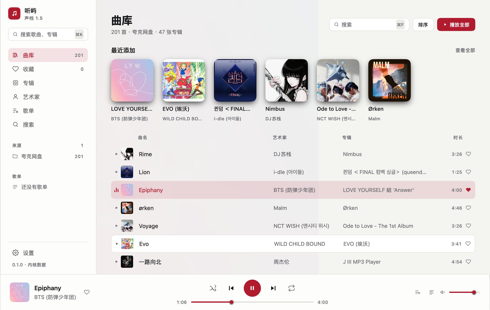 | 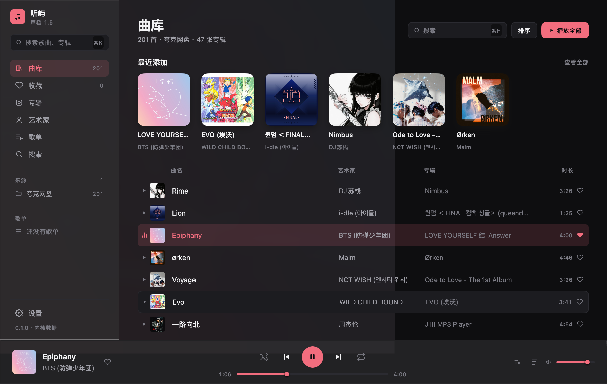 |

规格：

- 外壳：侧栏 236 px（Clear 玻璃 + 顶部 30% 封面氛围 + 1 px 右边框）＋ 内容区 ＋ 88 px 全宽传输条。
- 页头：标题 28/700 + 元信息 13（201 首 · 来源 · 专辑数）；右侧 32 px 高的搜索框（200）＋"排序"＋"播放全部"（朱红实底）。
- "最近添加"：6 张 104 px 封面卡（圆角 12、阴影 0 6 16 −4 @ 28%），标题 13/500、艺术家 11。
- 表格：列宽固定为 序号 22 + 封面 44 + 曲名 330 + 艺术家 170 + 专辑 210 + 弹性 + 时长 56 + 收藏 30；表头 11/600/+0.8 字距 26 px 高。
- 行状态：默认（无底）／悬停（墨 5%）／选中（Raised 白 + 1 px Border）／播放（AccentSoft 底、曲名朱红、左侧 3 条 2 px 高的律动条、收藏实心）；行高 44，圆角 8。
- 页脚：只留"已全部加载 · 共 201 首 / 按曲名排序"，**删掉数据库路径与 SQL 说明**。

**舞台**（浅色 / 深色）

| 浅色 | 深色 |
|---|---|
| 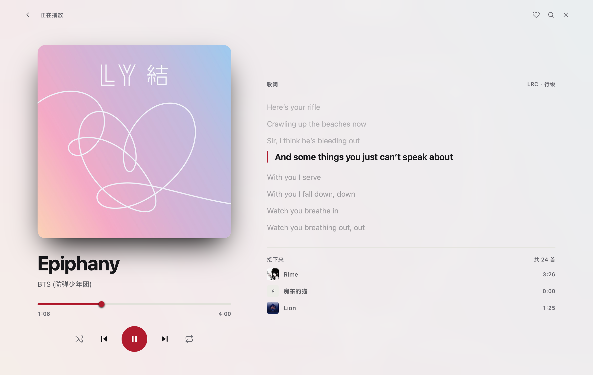 | 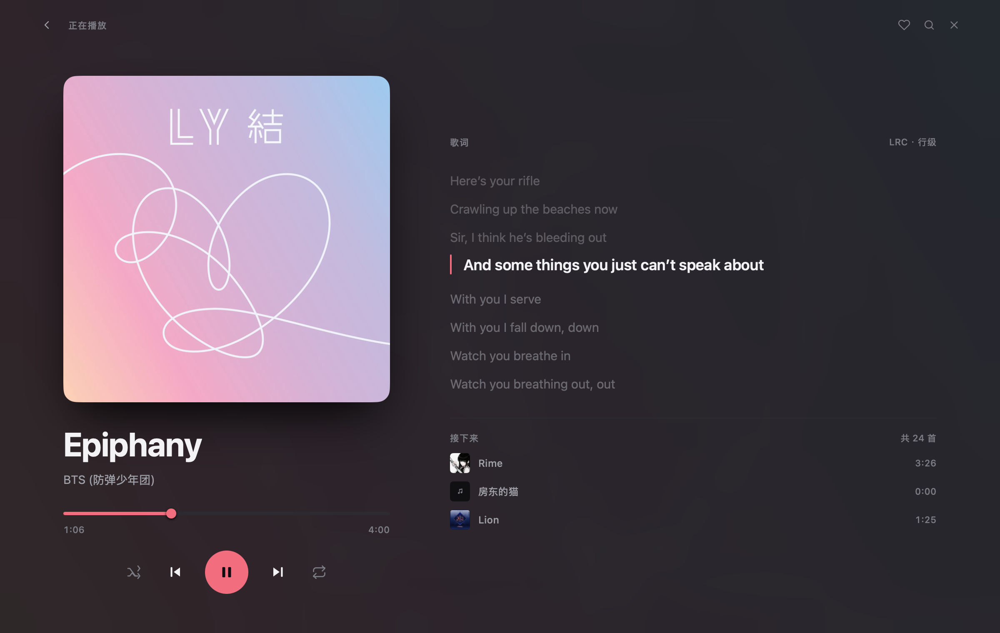 |

规格：

- 背景：封面取色的两色渐变，向 Canvas 混合 50%（"静室"只取一半强度）＋ 28 px 缩略图放大做 86% 洗过的氛围；无氛围图时退回中性渐变。
- 左列 392：封面 392（圆角 16、阴影 0 28 60 −18）→ 曲名 40/700 → 艺术家 14 → 进度 392×4（拇指 12）→ 时间 11（tnum）→ 控件行（shuffle 30 / prev 34 / play 52 / next 34 / repeat 30）。
- 右列：眉题"歌词 / LRC · 行级" → 8 行歌词（当前行 18/600 + 左侧 2×24 朱红竖条，其余 15、已唱 45% 透明、未唱 55%）→ 分隔线 → "接下来" 3 行（封面 24、标题 12、时长 11）。
- 顶部 60：返回 32、"正在播放" 11/600/+0.8、右侧收藏/匹配/关闭 30。
- 注：舞台封面从 M4 令牌的 360 提到 392（令牌已一并改为 392），因为内容区高度 760 − 60（顶栏）− 40（底距）− 118（标题/进度/控件）允许；360 会让封面在高窗口里显小。

**来源**（浅色 / 深色）

| 浅色 | 深色 |
|---|---|
| 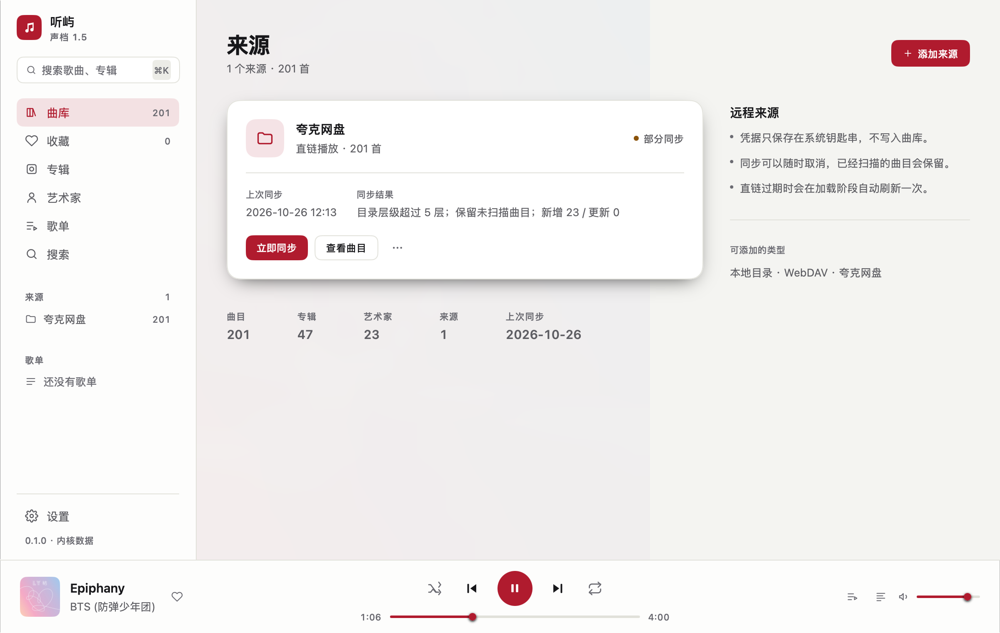 | 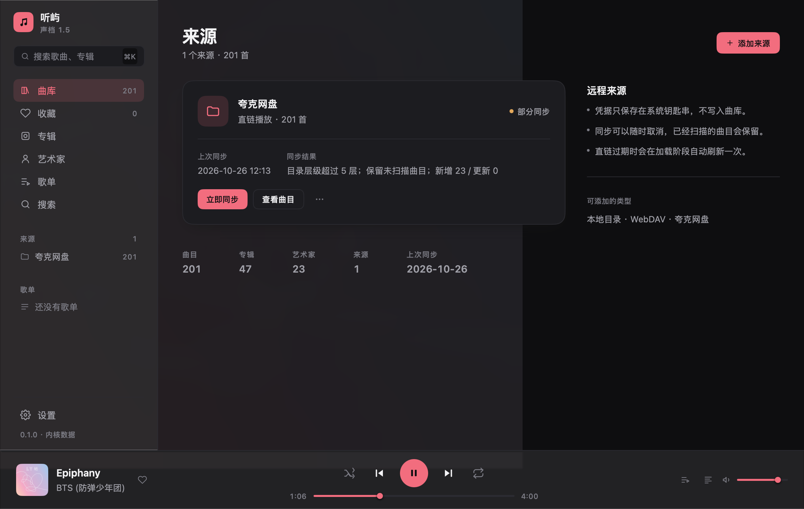 |

规格：

- 页头 + "添加来源"主按钮。
- 来源卡（最大 620、Raised、圆角 16、1 px 边框、阴影 0 8 24 −12）：46 px 图标砖 + 名称 17/600 + 一行元信息 + 右侧状态点"部分同步"（Warning 色） + 分隔线 + "上次同步 / 同步结果（新增/更新/移除）"两列 + 操作行（立即同步主按钮、查看曲目、更多）。
- 右侧 288 信息栏：三条短句（凭据在钥匙串 / 同步可取消 / 直链过期自动刷新）＋"可添加的类型"。
- 底部真实统计行：曲目 201 / 专辑 47 / 艺术家 23 / 来源 1 / 上次同步 2026-10-26。
- 相对现状：删掉三张功能说明卡，说明压成信息栏三条；空出来的地方放真实统计。

**设置**（浅色 / 深色）

| 浅色 | 深色 |
|---|---|
| 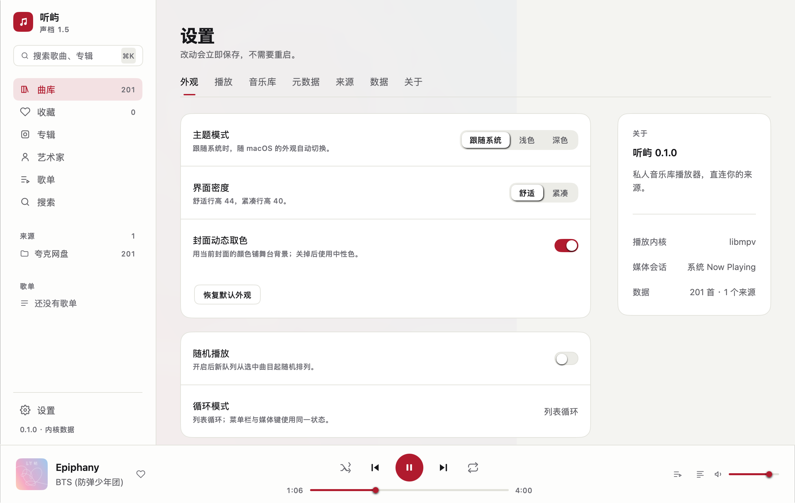 | 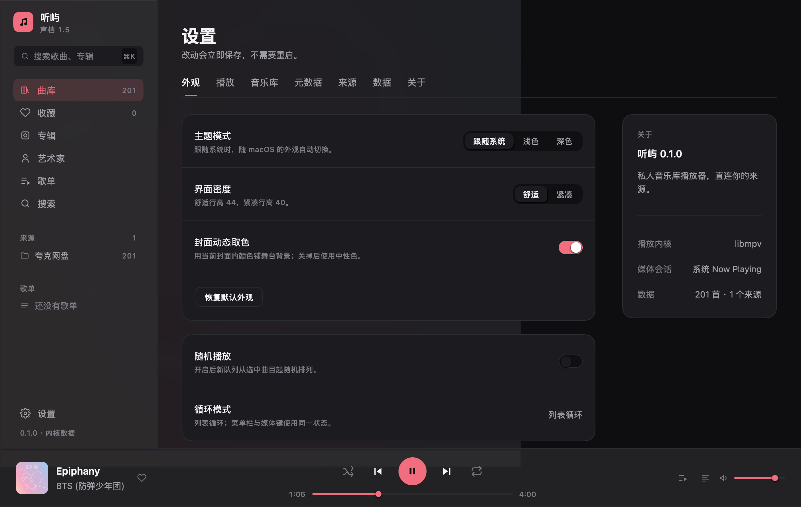 |

规格：

- 页头 + **横向 7 个分区标签**（外观/播放/音乐库/元数据/来源/数据/关于），当前项 2 px 朱红下划线 + 深色文字；取消第二列 208 px 导航。
- 内容 620：分组卡（Raised、圆角 16、1 px 边框）内每行 18/20 内边距，左侧标签 14 + 一句用户口径说明 12，右侧控件固定在同一列；行间 1 px 分隔。
- 外观组：主题（三段）、密度（两段）、封面动态取色（开关）＋"恢复默认外观"。
- 播放组：随机播放（开关）、循环模式（只读值）。
- 右侧"关于"卡：版本、播放内核、媒体会话、数据规模；**不出现 Flutter 版、M5 管线、settings.json 这类开发口径**。

### 4.4 组件与状态

| 组件 | 尺寸/令牌 | 状态 |
|---|---|---|
| 列表行 | 高 44、圆角 8、内边距 0/2 | 默认；悬停（墨 5%）；选中（Raised + 1 px Border）；播放（AccentSoft + 朱红曲名 + 律动条）；禁用（TextDisabled，无悬停）；键盘焦点（2 px Accent 环，缩进 1 px） |
| 封面卡 | 104×104 封面 + 13/500 + 11 | 默认；悬停（阴影 0 10 24 −6，封面不变形）；按下（封面 0.98，弹簧 0.16/1.0）；无封面（CoverPlaceholder + 音符图标） |
| 传输条 | 高 88、全宽、Clear 玻璃 + 顶部 1 px | 无曲（占位 + "去曲库"）；播放；暂停；缓冲（进度条 40% 高亮循环）；失败（Danger 文案 + 重试按钮） |
| 侧栏 | 236、Clear 玻璃 | 条目 34 高：默认/悬停（墨 4%）/当前（AccentSoft + 朱红 + 左侧 2 px）/计数徽标；分组标题 11/600/+0.8；空歌单（"还没有歌单" + 加号） |
| 弹层（菜单/命令面板/扫码） | 命令面板 560×可变、圆角 16、Regular 玻璃 + 0.3 遮罩 | 打开（160 ms 淡入 + 8 px 上移）；键盘上下选中；Esc 关闭；扫码面板 360×420（QR 168） |
| 空态 | 图标砖 56 + 标题 20/600 + 说明 13（最多 2 行）+ 主操作 32 | 空库；空收藏；空队列；空搜索结果（带"清除筛选"） |
| 加载态 | 骨架条 8 高、圆角 4、Shimmer 1400 ms；列表首屏 6 行 | 首屏；翻页（底部 28 高"正在加载…"+ Spinner）；封面未解码（占位砖） |
| 错误态 | Danger 色、行内 12/500；全局条 44 高、Raised + 1 px Danger 边框 | 库打不开（整页说明 + 重试）；播放失败（行内 + 舞台条）；同步失败（来源卡状态点 Danger + 文案）；只读模式（页脚提示） |

### 4.5 动效规格

统一口径：`ui.SpringOptions{Duration: response, Bounce: 1−damping}`；MyGo 的 `Duration` 是弹簧无阻尼周期（与 SwiftUI 的 response 同义），`Bounce` 是 1−damping。减速曲线为 `cubic-bezier(0.2, 0, 0, 1)`（现有 `tokens.Easing`）。

| 对象 | 触发 | 参数 | 可中断 | 减弱动效 |
|---|---|---|---|---|
| 按下反馈（行/按钮/卡） | 指针按下即开始 | 缩放 0.98，弹簧 response 0.16 s / damping 1.0；松手从**当前**缩放值反向 | 是（松手/再次按下） | 只做 60 ms 颜色变化，无缩放 |
| 悬停（行/卡） | 指针进入 | 背景 α 0→5%，90 ms cubic(0.2,0,0,1) | 是（离开即反向） | 立即切换，无过渡 |
| 舞台展开 | 点行/封面卡 | 封面 `ElementTransition.Match`：从 30 或 104 → 392，response 0.34 s / damping 1.0；文字块 160 ms 交叉淡入 | 是：展开途中按返回，从当前几何反向；再次点同一封面接管速度 | 120 ms 交叉淡入，不缩放、不移动 |
| 舞台收起 | 返回/Esc | 同一条弹簧反向，0.34 s / 1.0 | 是 | 120 ms 淡出 |
| 列表→播放 | 播放按钮 | 封面 Match（同路径）+ 文本 160 ms；不新增别的共享元素 | 是 | 100 ms 淡入 |
| 歌词行切换 | 播放位置跨行 | 160 ms 颜色/字重交叉；当前行竖条 2×24 | 是（连续跨行只追赶当前行） | 直接换色，无过渡 |
| 拖动进度 | 按下进度条 | 拇指 9→13，120 ms；拖动 1:1 跟手（`DragOffset`），拖动期间**不 seek**；松手 seek 一次，拇指 200 ms 回位 | 是（拖动中再次抓住即可反向） | 同左（拖动不是动画） |
| 音量拖动 | 按下音量 | 1:1 跟手，无吸附；松手不回弹 | 是 | 同左 |
| 甩动翻页（歌词/队列分页） | 快速横甩 | 落点 = 位移 + 速度×0.12 s；|v|≥550 DIP/s 或位移≥35% 宽度则翻页；弹簧 response 0.32 s / damping 0.82（Bounce 0.18），`Velocity` 交给弹簧 | 是（反向甩动接管速度） | 直接切页 |
| 列表首屏加载 | 进入页面 | 骨架 6 行，Shimmer 1400 ms 线性循环 | 不适用 | 静态骨架，无 Shimmer |
| 空态出现 | 数据为空 | 180 ms 淡入，无位移 | 是 | 立即 |

### 4.6 能力边界

**在 MyGo `ui` 能力内可做**：全部静态样式（渐变、阴影、圆角、玻璃、封面图、字距/行高/tnum）、按下与悬停、弹簧与速度交接（`SpringOptions.Velocity`）、共享封面（`ElementTransition.Match`）、减弱动效（`Preferences.ReduceMotion`）、键盘焦点环、右键菜单、分段/开关/滑杆/列表/表格、扫码面板（`go-qrcode` 已在用）。
**需要额外能力**：无。唯一的可选增强：逐字歌词需要"播放位置 → 逐字进度"的纯函数与更细的行时间分摊（应用层代码，约 1 人日），A 的静态设计只用到行级，不阻塞。

---

## 5. 方向 B · 舞台「潮汐」

### 5.1 定位与情绪

**定位**：封面成为唯一的高饱和；侧栏退成玻璃顶栏，曲库是封面网格，舞台是整页的封面与光。
**情绪**：鲜活、有舞台感，像把一张唱片放到灯下。

### 5.2 令牌

#### 颜色

| 角色 | 浅色 | 深色 | 用途 |
|---|---|---|---|
| Canvas | `#F5F6F8` | `#0B0D10` | 页面底（其上叠封面氛围） |
| Surface | `#FFFFFF` | `#14171B` | 卡片 |
| SurfaceRaised | `#FFFFFF` | `#191D22` | 浮层 |
| SurfaceSunken | `#EDEFF3` | `#0D0F12` | 输入/槽 |
| Border | `#E2E5EA` | `#262A31` | 1 px |
| BorderStrong | `#CDD2DA` | `#343A43` | 选中 |
| Text | `#14161A` | `#F5F6F8` | 主文本 |
| TextSecondary | `#5C626C` | `#A7ADB6` | 次级 |
| TextTertiary | `#696F78` | `#7C838C` | 元信息 |
| TextDisabled | `#A2A8B1` | `#565D66` | 禁用 |
| Accent | `#C92B54` | `#FF6E8A` | 主按钮、进度、当前歌词竖条 |
| AccentSoft | `#C92B54` @ 12% | `#FF6E8A` @ 15% | 选中 |
| OnAccent | `#FFFFFF` | `#0B0D10` | 强调底字 |
| Success | `#1E6B49` | `#5BD98F` | 同步 |
| Warning | `#8A5209` | `#E3A85B` | 提示 |
| Danger | `#A8201A` | `#FF7066` | 失败 |
| GlassTint | `#FFFFFF` @ 0.62 | `#14171B` @ 0.66 | 玻璃 |
| Scrim | 黑 @ 0.34 | 黑 @ 0.52 | 遮罩 |

对比度：浅色 16.75 / 5.68 / 4.68 / 4.91（强调，AA 小字达标）/ 5.31；深色 17.99 / 8.61 / 5.08 / 7.27 / 7.27。**舞台上的文字另加 0.52（浅）/0.42（深）的 Canvas 面纱**，实际对比度高于表值。

#### 字号阶梯

| 角色 | 字号 | 字重 | 行高 | 字距 | 用例 |
|---|---|---|---|---|---|
| display | 56 | 700 | 1.02 | −1.4 | 舞台曲名 |
| h1 | 34 | 700 | 1.12 | −0.9 | 页面标题 |
| h2 | 22 | 600 | 1.24 | −0.3 | 来源名、艺术家 |
| h3 | 16 | 600 | 1.40 | 0 | 卡片标题 |
| body | 15 | 400 | 1.60 | 0 | 正文 |
| small | 13 | 400 | 1.50 | +0.1 | 次级 |
| caption | 13 | 500 | 1.35 | +0.1 | 网格卡标题 |
| label | 12 | 500 | 1.35 | +0.2 | 导航、标签 |
| overline | 11 | 600 | 1.20 | +1.2 | 眉题 |
| num | 12 | 500 | 1.30 | 0 | 时间（tnum） |
| numSm | 11 | 500 | 1.25 | +0.2 | 计数（tnum） |
| lyric | 19 | 500 | 1.72 | 0 | 歌词 |
| lyricActive | 24 | 600 | 1.40 | −0.5 | 当前歌词 |

#### 间距、圆角、尺寸、动效常量

- 间距：4 / 8 / 12 / 16 / 24 / 32 / 40 / 48 / 64 / 80。
- 圆角：XS 6 / SM 10 / MD 16 / LG 22 / XL 28 / Pill 999。
- 尺寸：页面内边距 48、网格封面 180（5 列 × 32 gap）、行高 56、浮动传输条 760×72（距底 24）、舞台封面 420、顶栏 64。
- 动效：按下 0.15 / 1.0；舞台 0.42 / 0.88；收起 0.38 / 0.90；背景交叉淡入 700 ms；逐字无弹簧（位置的纯函数）；横甩 0.38 / 0.78 + 速度交接。

### 5.3 关键页面

**曲库**（浅色 / 深色）

| 浅色 | 深色 |
|---|---|
| 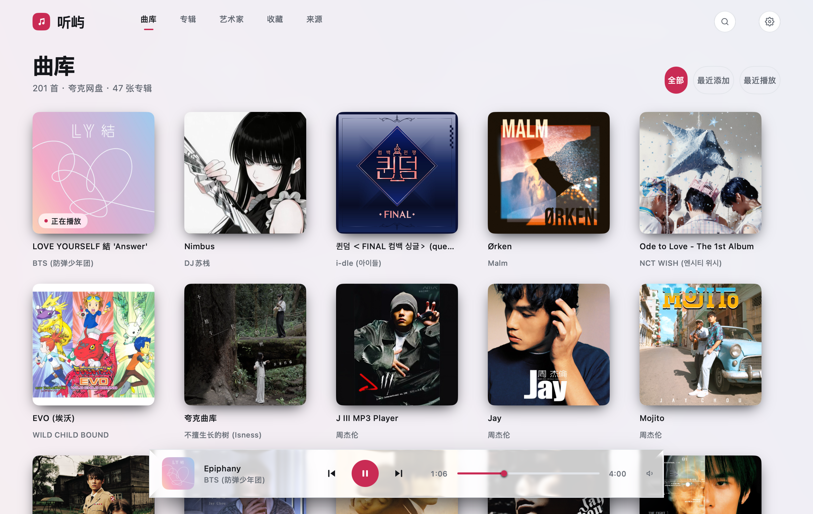 | 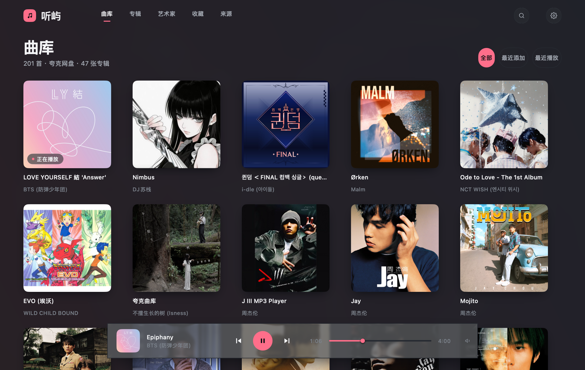 |

规格：

- 背景：封面取色渐变（Canvas 混合 84–92%）+ 1000 px 缩略图放大、90% 洗过的氛围；无取色时中性渐变。
- 顶部 64 玻璃栏：logo 26 + "听屿" 20/700，五个目的（当前项 2 px 下划线），右侧搜索/设置玻璃圆钮 32（1 px 边框）。
- 页头：34/700 + 13 元信息；右侧三枚筛选 pill（当前项实底）。
- 网格：5 列 × 180 封面（圆角 10、阴影 0 8 22 −8）、gap 32；第三行滚到浮动条下方，用来展示材质。
- 浮动传输条：760×72、圆角 20、Regular 玻璃 + 1 px 边框 + 阴影 0 18 44 −16；内容：封面 48、曲名 12/500、上一首 30/播放 40/下一首 30、已播 11、进度 210×3、总时长、音量、队列。
- "正在播放"徽标（74×22、玻璃、圆角 11）贴在当前专辑封面左下 8/18。

**舞台**（浅色 / 深色）

| 浅色 | 深色 |
|---|---|
| 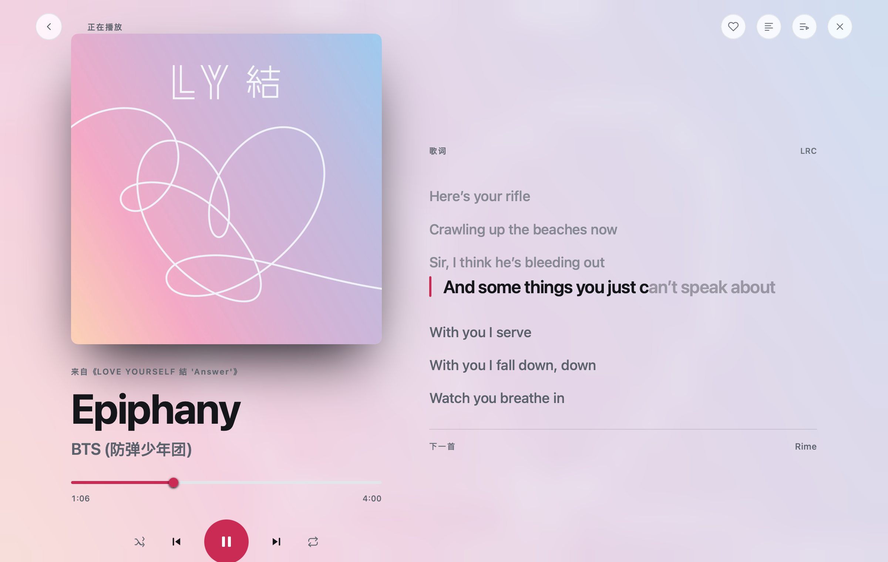 | 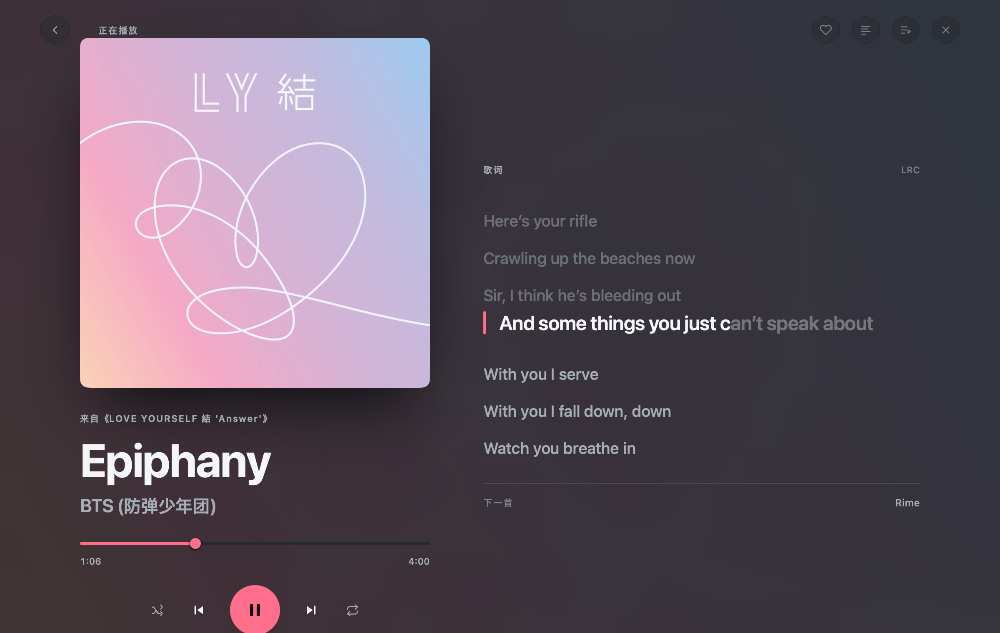 |

规格：

- 背景：封面取色全强度渐变 + 全窗 28 px 缩略图（42% 不透明度）+ Canvas 面纱（0.52 / 0.42）；深色再向 Canvas 混合 55%，保证字数对比。
- 顶部 72：返回 36 玻璃圆、眉题"正在播放"、右侧收藏/歌词/队列/关闭 34 玻璃圆（1 px 边框）。
- 左列 420：封面 420（圆角 10、阴影 0 36 80 −24）→ "来自《专辑》" 11 → 曲名 56/700 → 艺术家 22 → 进度 420×4（拇指 13）→ 时间 11 → 控件（26/30/60/30/26）。
- 右列：眉题"歌词 / LRC" → 7 行歌词（当前 24/600，左侧 3×28 玫红竖条；**当前行按 62% 字位分两段着色**，已唱 Text、未唱 34% 透明）→ 1 px 分隔 → "下一首 / Rime"。
- 设计意图：舞台不显示全局传输条，页内控件即传输条；空间一致性靠封面 Match 保持。

**来源**（浅色 / 深色）

| 浅色 | 深色 |
|---|---|
| 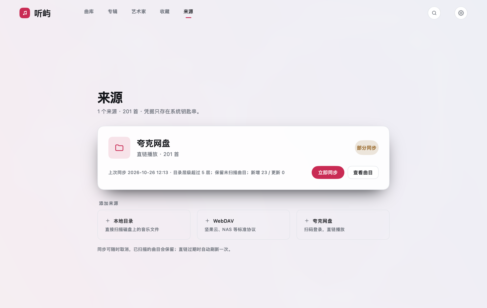 | 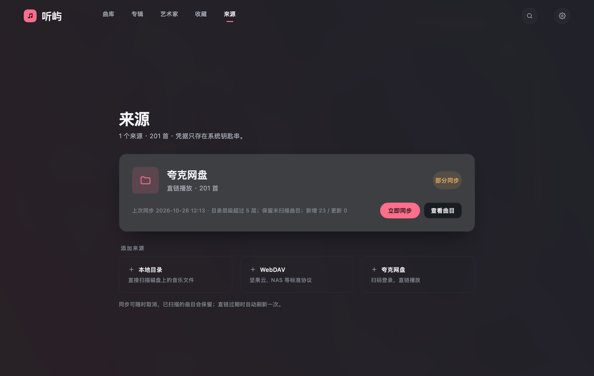 |

规格：

- 720 居中列，垂直居中：34/700 标题 + 13 说明 → 玻璃卡（26 内边距、圆角 16、阴影 0 18 44 −20）：56 图标砖 + 来源名 22 + 元信息 + 右上"部分同步"（Warning）胶囊 + 分隔 + "上次同步" + 右侧"立即同步"（实底 pill）/ "查看曲目" → "添加来源"三种瓷砖（本地目录/WebDAV/夸克，各带一句）→ 一句说明。
- 相对现状：说明卡变成三种"添加方式"瓷砖，每种是一个真实动作。

**设置**（浅色 / 深色）

| 浅色 | 深色 |
|---|---|
| 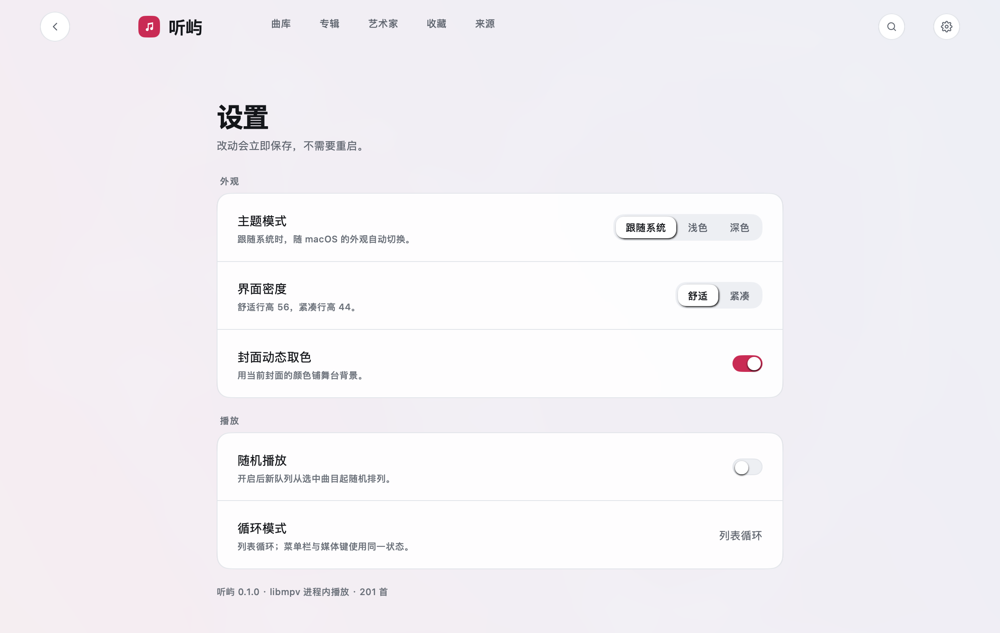 | 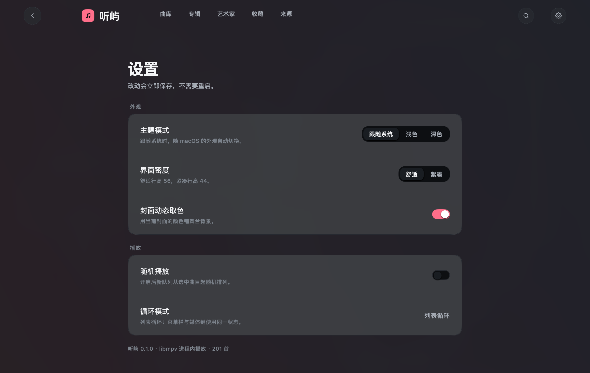 |

规格：

- 居中 680 列：34/700 + 13；分区眉题 11/600/+1.2 放在卡外；玻璃卡内每行 20/24 内边距，左侧 15 + 12 说明，右侧控件；行间 1 px。
- 外观 3 行、播放 2 行、底部版本行；整列垂直居中。

### 5.4 组件与状态

| 组件 | 尺寸/令牌 | 状态 |
|---|---|---|
| 网格卡 | 180 封面 + 13/500 + 11，gap 32 | 默认；悬停（封面 1.03 + 阴影加深 160 ms）；按下（0.98，0.15/1.0）；当前专辑（玻璃徽标"正在播放"）；无封面（占位砖） |
| 列表行（来源/队列页） | 高 56 | 默认；悬停（墨 5%）；选中（Raised）；播放（AccentSoft + 玫红标题） |
| 浮动传输条 | 760×72、Regular 玻璃、圆角 20 | 无曲（隐藏条，页脚"从曲库开始"）；播放；暂停；缓冲（进度 40% 循环）；失败（条右 Danger 图标 + 气泡） |
| 顶栏 | 64、Clear 玻璃、1 px 底边 | 当前目的（2 px 下划线 + Text）；悬停（墨 4%）；滚动时底边变 BorderStrong |
| 弹层 | 命令面板 560、圆角 22、Regular 玻璃；菜单 240×可变 | 打开（200 ms 淡入 + 12 px 上移，从触发元素锚定）；Esc；键盘循环 |
| 空态 | 140 px 内容块：图标 56 + 22/600 + 13 + 胶囊按钮 | 空库（"添加第一个来源"）；空收藏；空队列；空来源（显示三种添加瓷砖） |
| 加载态 | 网格骨架 5×2 卡（封面 180 圆角 10 + 两行 10 高骨架）；Shimmer 1400 ms | 首屏；翻页（底部胶囊"正在加载"） |
| 错误态 | 全窗 0.34 遮罩 + 440 宽玻璃卡：Danger 图标 + 16/600 + 13 + 两个按钮 | 库打不开；同步失败；播放失败 |

### 5.5 动效规格

| 对象 | 触发 | 参数 | 可中断 | 减弱动效 |
|---|---|---|---|---|
| 按下反馈 | 按下传输按钮/卡片 | 缩放 0.92（按钮）/0.98（卡），0.15 s / 1.0 | 是 | 60 ms 透明度 |
| 网格悬停 | 指针进入 | 封面 scale 1→1.03 + 阴影 8→18，160 ms | 是 | 不缩放，只加深阴影 |
| 舞台展开 | 点网格卡/传输条封面 | 封面 Match 180→420，0.42 s / damping 0.88（Bounce 0.12）；标题/艺术家 180 ms 交叉；背景 700 ms | 是（返回键从当前几何反向；再次点封面接管速度） | 160 ms 交叉淡入，无缩放 |
| 舞台收起 | 返回/Esc | 0.38 s / 0.90 | 是 | 160 ms 淡出 |
| 列表→播放 | 行/卡片 | 同一 Match + 文本 180 ms；封面是唯一共享元素 | 是 | 160 ms 淡入 |
| 背景换歌 | 曲目切换 | 双画布交叉淡入 700 ms（旧背景保留到淡完），与播放位置无关 | 不锁输入；不可被手势反向（淡入本身就是过渡） | 200 ms 淡入 |
| 拖动进度 | 按下进度条 | 1:1；时间气泡 22 高、圆角 11、玻璃，跟随拇指上方 8 px；松手 seek 一次，拇指 0.30/1.0 回位 | 是 | 同左 |
| 音量拖动 | 同上 | 1:1，无吸附 | 是 | 同左 |
| 封面横甩换歌 | 封面水平拖动 | 拖动 1:1 + 位移（最多 ±40% 宽）+ scale 1→0.96；释放落点 = 位移 + v×0.12 s；|v|≥550 DIP/s 或 |dx|≥35% 宽 → 进下一首/上一首：0.38 s / damping 0.78，速度交给弹簧；否则 0.35 s / 0.90 回位 | 是（反向甩动从当前位置接管速度） | 只做换歌时 160 ms 淡入，无位移/缩放 |
| 逐字歌词 | 播放位置推进 | 逐字进度 = f(位置)；当前行内按字宽分摊，无弹簧；行切换 200 ms 交叉 | 是（seek 后直接跳到新位置） | 整行直接着色，无逐字动画 |

### 5.6 能力边界

**在 MyGo `ui` 能力内可做**：封面网格、玻璃顶栏/浮动条/卡片（`glass.Glass`，小浮层 Regular、大表面 Clear）、封面取色（`internal/images.Extract`，M5 已有）、双画布交叉淡入（两个 Image + `AnimateTo` 透明度）、横甩（`Draggable` + `DragOffset` + `DragVelocity` + `SpringOptions.Velocity`）、逐字（`RichText` 两段 + 位置的纯函数）、Match 舞台展开、减弱动效。
**需要额外能力**：
1. **逐字时间分摊**：现有 LRC 只有行时间，需要把行时长按字号宽度分摊到字（`SpreadWords` 等价物）；应用层纯函数，约 1 人日，不依赖新库。
2. **刘海迷你播放器**（报告 §3.11，P2，不在本次四页内）：MyGo 无刘海窗口 API，需要 purego/objc 自建 `NSPanel` + 屏幕 safeAreaInsets + 自管指针与点透（约 100–150 行），并单独立项。
3. **可选**：背景"雾"shader（报告 §3.9）需要 `ui/shader` 自定义效果，本次不采用——静态模糊缩略图放大已达成同一观感，且不增帧预算。

---

## 6. 方向 C · 控制台「灰阶」

### 6.1 定位与情绪

**定位**：一台专业播放器。表格是页面主体，右侧检查器常驻显示正在播放、队列与技术信息，数字用等宽数字（tabular figures），动效最短。
**情绪**：精密、克制，信息密度带来掌控感。

### 6.2 令牌

#### 颜色

| 角色 | 浅色 | 深色 | 用途 |
|---|---|---|---|
| Canvas | `#F5F6F7` | `#0F1113` | 页面底 |
| Surface | `#FFFFFF` | `#16191C` | 侧栏、工具栏 |
| SurfaceRaised | `#FFFFFF` | `#1B1F22` | 卡片、选中行 |
| SurfaceSunken | `#EDEFF1` | `#0C0E10` | 检查器、槽 |
| Border | `#DDE1E5` | `#282C31` | 行分隔 |
| BorderStrong | `#C4CAD1` | `#3A3F45` | 选中轮廓 |
| Text | `#121518` | `#EDEFF2` | 主文本 |
| TextSecondary | `#58606A` | `#A2A9B2` | 次级 |
| TextTertiary | `#666D77` | `#7A828C` | 元信息、表头 |
| TextDisabled | `#9AA1A9` | `#555C64` | 禁用 |
| Accent | `#8A5307` | `#E3B56B` | 主按钮、播放态、进度 |
| AccentSoft | `#8A5307` @ 12% | `#E3B56B` @ 13% | 播放行 |
| OnAccent | `#FFFFFF` | `#0F1113` | 强调底字 |
| Success | `#1C6B45` | `#5BD98F` | 同步 |
| Warning | `#8A5307` | `#E3B56B` | 提示 |
| Danger | `#A3201B` | `#FF7066` | 失败 |
| GlassTint | `#F5F6F7` @ 0.80 | `#16191C` @ 0.82 | 侧栏/工具栏（近乎实底） |
| Scrim | 黑 @ 0.40 | 黑 @ 0.54 | 遮罩 |

对比度：浅色 16.93 / 5.89 / 4.83 / 强调 5.84 / 强调底白字 6.32；深色 16.42 / 7.98 / 4.86 / 强调 9.99 / 9.99。

#### 字号阶梯

| 角色 | 字号 | 字重 | 行高 | 字距 | 用例 |
|---|---|---|---|---|---|
| display | 24 | 600 | 1.15 | −0.3 | 舞台曲名 |
| h1 | 20 | 600 | 1.20 | −0.2 | 页面/工具栏标题 |
| h2 | 14 | 600 | 1.35 | 0 | 分区标题 |
| h3 | 12 | 600 | 1.35 | +0.1 | 小标题 |
| body | 13 | 400 | 1.45 | 0 | 正文、表格曲名 |
| small | 12 | 400 | 1.40 | 0 | 行内次级 |
| caption | 12 | 500 | 1.35 | +0.1 | 卡片 |
| label | 11 | 500 | 1.30 | +0.2 | 按钮/标签 |
| overline | 10 | 600 | 1.20 | +0.6 | 表头、眉题 |
| num | 12 | 500 | 1.30 | 0 | 时长（tnum） |
| numSm | 10 | 500 | 1.20 | +0.2 | 技术信息（tnum） |
| lyric | 14 | 400 | 1.85 | 0 | 歌词 |
| lyricActive | 16 | 600 | 1.60 | −0.1 | 当前歌词 |

#### 间距、圆角、尺寸、动效常量

- 间距：2 / 4 / 6 / 8 / 10 / 12 / 16 / 20 / 24 / 32。
- 圆角：XS 2 / SM 4 / MD 6 / LG 8 / XL 10 / Pill 999。
- 尺寸：侧栏 208、工具栏 48、设置导航 168、表头 26、行高 36、检查器 280、传输条 56（全宽）、舞台封面 328、页面内边距 20。
- 动效：按下 0.10 / 1.0；舞台 0.22 / 1.0；列表→舞台 0.16 / 1.0；进度 0.24 / 1.0；悬停 60 ms；减弱动效全部 0 ms（直接切换）。

### 6.3 关键页面

**曲库**（浅色 / 深色）

| 浅色 | 深色 |
|---|---|
| 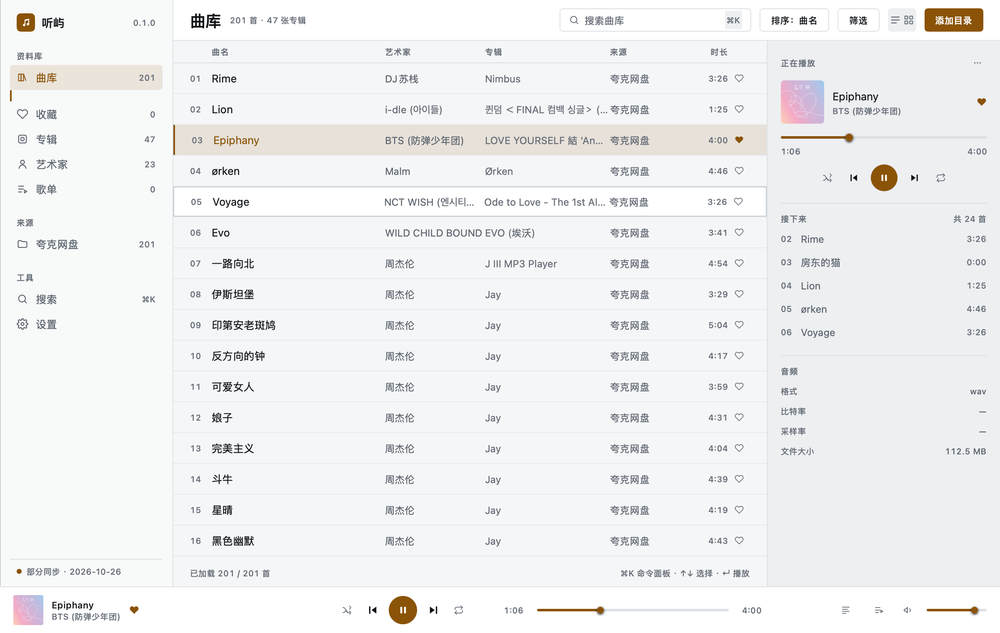 | 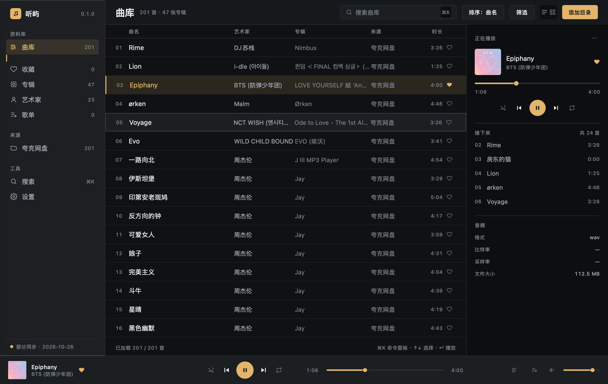 |

规格：

- 侧栏 208（Clear 玻璃 0.80，近乎实底）：logo 22 + "听屿" + 版本；"资料库"分组（曲库/收藏/专辑/艺术家/歌单 + 计数）、"来源"分组（夸克网盘 201）、"工具"（搜索 ⌘K / 设置）；底部同步状态点。
- 主区：全宽工具栏 48（标题 20 + 计数 11 + 搜索 230 + 排序 + 筛选 + 视图切换 + "添加目录"实底 28）；表头 26（# / 曲名 / 艺术家 120 / 专辑 150 / 来源 90 / 时长 52 / ♡ 26）。
- 行 36：默认透明；选中（Raised + 1 px BorderStrong）；播放（AccentSoft + 左侧 2 px 琥珀边 + 琥珀曲名）；行间 1 px Border @60%；16 行填满首屏，底部"已加载 201/201" + 快捷键提示。
- 右侧检查器 280：正在播放（封面 52 + 曲名 13 + 艺术家 11 + 进度 248 + 控件）、"接下来 共 24 首"（5 行 28）、"音频"（格式/比特率/采样率/大小，全部 tnum）——技术信息只在这里出现。
- 传输条 56 全宽：左 300（封面 36 + 曲名 12 + 艺术家 10 + 收藏）、中（shuffle 24/prev 26/play 34/next 26/repeat 24 + 时间 + 进度 230）、右（歌词/队列/音量 72）。

**舞台**（浅色 / 深色）

| 浅色 | 深色 |
|---|---|
| 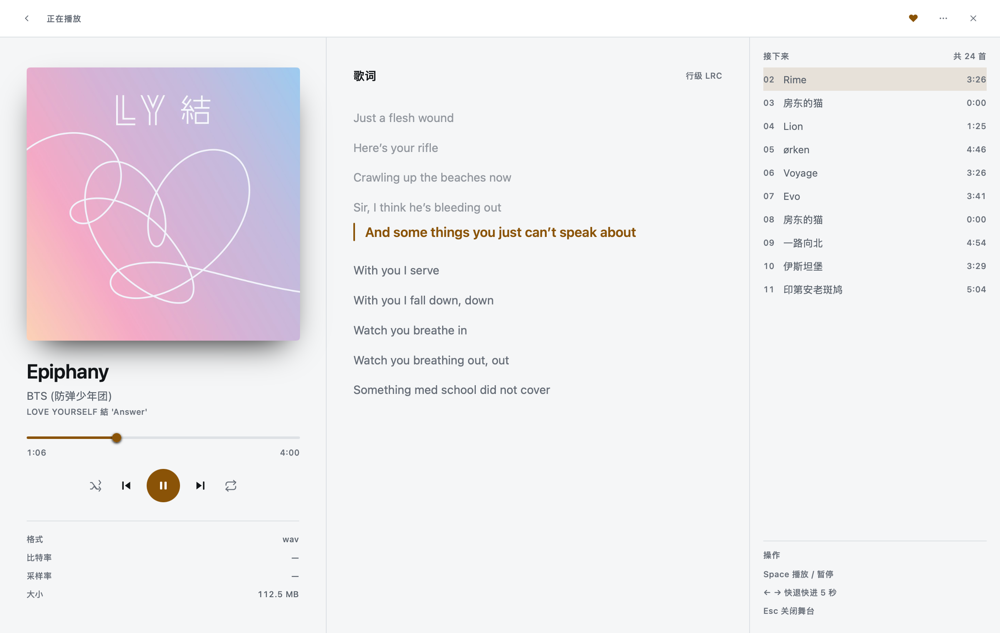 | 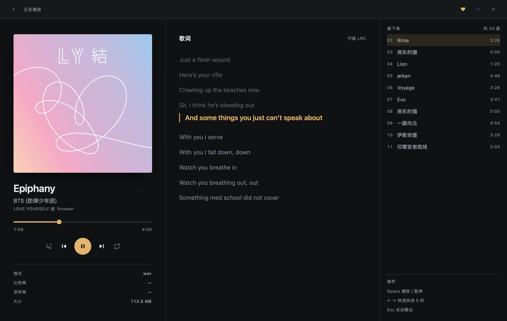 |

规格：

- 顶栏 44：返回 + "正在播放" + 收藏/更多/关闭；无全局传输条。
- 三段式：左 392（封面 328、曲名 24、艺术家 13、专辑 · 年份 11、进度 328、控件、底部技术信息 4 行）；中（歌词 14/16，当前行琥珀 + 2×22 竖条）；右 280（"接下来" 10 行、"操作" 3 条快捷键提示）。
- 背景：纯 Canvas，无取色、无氛围；封面是唯一图片。

**来源**（浅色 / 深色）

| 浅色 | 深色 |
|---|---|
| 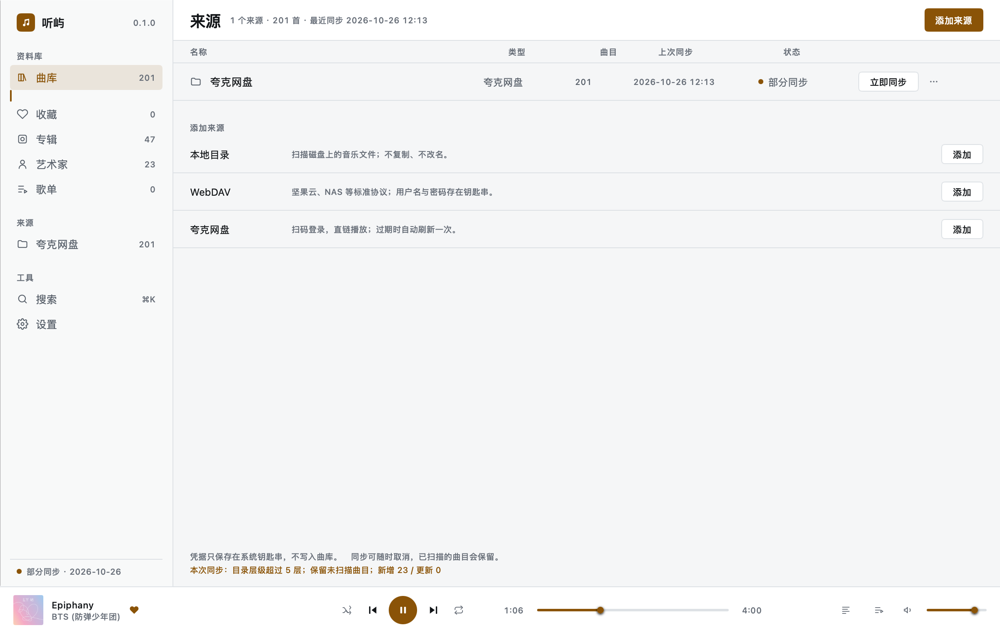 | 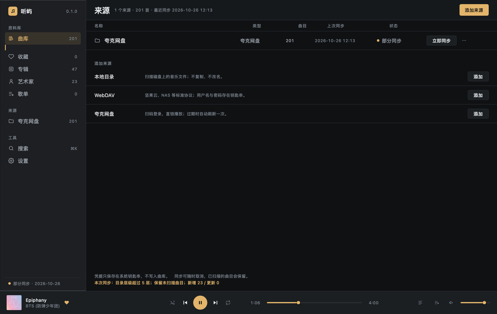 |

规格：

- 工具栏 48：标题 + "1 个来源 · 201 首 · 最近同步 2026-10-26 12:13" + "添加来源"实底。
- 表头 26（名称/类型/曲目/上次同步/状态/操作）；行 44（文件夹图标 + 名称、夸克网盘、201、时间戳、状态点、立即同步 + 更多）。
- "添加来源"分区：三行 44（本地目录 / WebDAV / 夸克网盘 + 一句说明 + "添加"按钮）。
- 页脚两句：凭据在钥匙串、同步可取消。

**设置**（浅色 / 深色）

| 浅色 | 深色 |
|---|---|
| 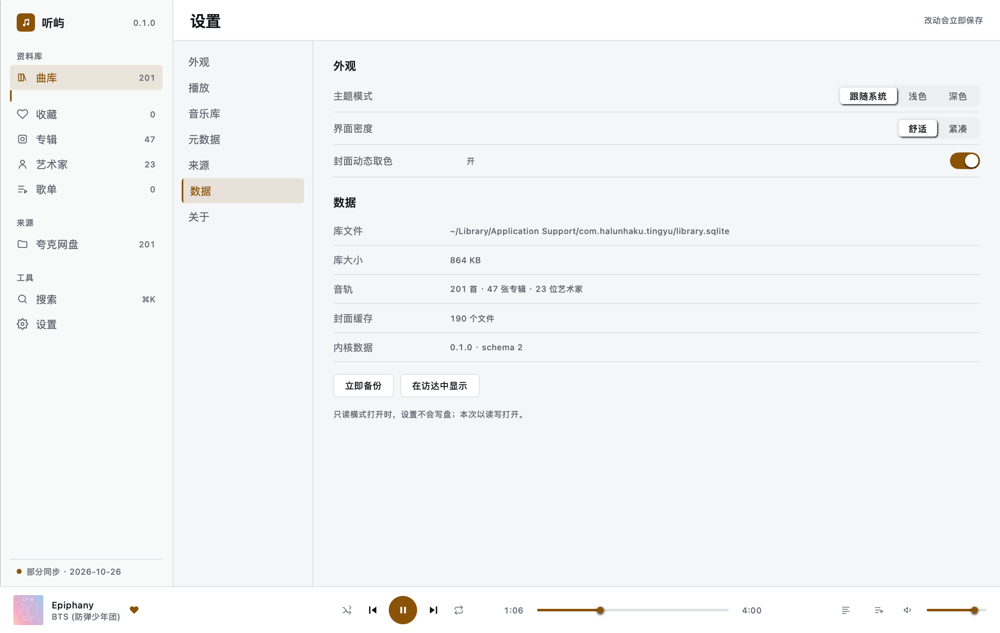 | 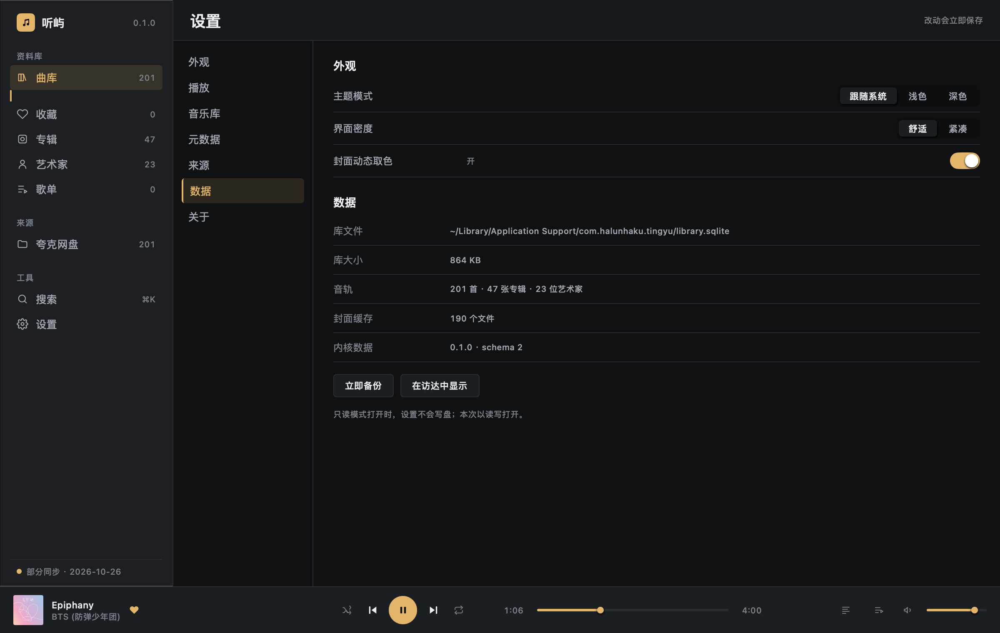 |

规格：

- 工具栏 48 + 两栏：设置导航 168（7 项，当前项 AccentSoft + 左侧 2 px 琥珀边）+ 内容（20/24 内边距）。
- "外观"：主题/密度/动态取色，行高 38，右侧控件固定列。
- "数据"：库文件（`~/…/library.sqlite`，等宽数字）、库大小（864 KB）、音轨规模、封面缓存 190、内核数据 0.1.0 · schema 2；"立即备份""在访达中显示"按钮；只读模式说明。
- 技术路径只在这一页出现，符合"专业"定位。

### 6.4 组件与状态

| 组件 | 尺寸/令牌 | 状态 |
|---|---|---|
| 表格行 | 高 36、内边距 0/20、分隔 1 px | 默认；悬停（墨 4%）；选中（Raised + 1 px BorderStrong）；播放（AccentSoft + 左 2 px + 琥珀标题）；禁用；键盘焦点（1 px Accent 内缩环） |
| 卡片 | 圆角 6、内边距 16 | 默认；悬停（BorderStrong）；无封面（占位） |
| 传输条 | 高 56、全宽、实底 SurfaceRaised + 顶部 1 px | 无曲（左"未在播放"灰）；播放；暂停；缓冲（进度 40%）；失败（Danger 图标 + 提示条 44） |
| 侧栏 | 208、Clear 玻璃 0.80 | 条目 30：默认/悬停 4%/当前 AccentSoft + 左 2 px；分组眉题 10/600/+0.6；计数 tnum |
| 检查器 | 280、SurfaceSunken、左 1 px | 有曲（完整）；无曲（"未在播放"+ 去曲库）；队列空（"队列为空"） |
| 弹层 | 菜单 220、命令面板 560、圆角 8、Regular 玻璃 | 打开 120 ms 淡入 + 4 px 上移；方向键选择；Esc |
| 空态 | 内容块 120：图标 40 + 14/600 + 12 + 按钮 28 | 空库/空收藏/空队列/搜索无结果 |
| 加载态 | 行骨架 16 高的 60% 宽条；表头先出 | 首屏；翻页（底部 24 高"加载中"） |
| 错误态 | 行内 11/500 Danger；全局条 40 + 1 px Danger | 库打不开（整页 2 行 + 重试）；播放失败（行内红点 + 舞台提示）；同步失败（状态点 Danger） |

### 6.5 动效规格

| 对象 | 触发 | 参数 | 可中断 | 减弱动效 |
|---|---|---|---|---|
| 按下反馈 | 按下按钮/行 | 背景 α 0→8%，60 ms；无缩放 | 是 | 无动画 |
| 悬停 | 指针进入 | 背景 α 0→4%，60 ms | 是 | 无动画 |
| 舞台展开 | 点行/封面 | 面板 0.22 s / damping 1.0（无共享元素，只做面板展开）；标题 120 ms | 是 | 0 ms，直接显示 |
| 列表→舞台 | 行双击/Enter | 160 ms 交叉淡入；**不使用 Match**，空间一致性被有意牺牲 | 是 | 120 ms 淡入 |
| 拖动进度 | 按下进度条 | 1:1；松手 seek 一次并对齐 0.5 s；时间气泡 11/tnum 跟随 | 是 | 同左 |
| 音量拖动 | 同上 | 1:1，无吸附 | 是 | 同左 |
| 滚轮翻页 | 列表滚动 | 系统滚动动量，无弹簧 | 系统行为 | 同系统 |
| 选中/播放切换 | 点击行 | 0 ms 切换底色（只做颜色，不做位移） | 是 | 0 ms |

### 6.6 能力边界

**在 MyGo `ui` 能力内可做**：36 px 表格（`ui.List` 虚拟化）、右侧检查器、等宽数字（`FontFeatures("tnum")`）、键盘焦点/上下选择、快捷键提示、玻璃侧栏（Clear）、技术信息面板（`library.Track` 已有 Bitrate/SampleRate/FileFormat/FileSize）。
**需要额外能力**：无。注：真正的等宽字体（而非 tabular）需要打包字体文件（约 1–3 MB + 许可），C 刻意不依赖它，只用 tnum，所以不受影响。

---

## 7. 与 egoist/mygo-cloudmusic 的对照

依据 `docs/research/2026-10-26-mygo-cloudmusic-reference.md`（AGPL-3.0；只借做法与参数，不复制代码）。

### 7.1 值得吸收

| 做法 | 报告位置 | 本设计怎么用 | 方向 |
|---|---|---|---|
| 拖动只改显示值、松手才 seek 一次，且不 seek 到末尾 | §3.2 / §3.4 | 三个方向的进度拖动都规定"拖动中 0 次 seek、松手 1 次"；A/B 的拇指跟手不吸附 | A/B/C |
| 换歌背景 700 ms 双画布交叉淡入，旧图留到淡完 | §3.8 / §3.9 | B 舞台背景规格 700 ms，旧背景保留；A 的舞台取色只做一次交叉，不做 30 fps 雾 | A/B |
| 封面取色：24 px 缩略、12/18 色相桶、灰度兜底 | §3.8 | 渲染器直接调用 M5 的 `internal/images.Extract`（我们自己的规格，不用它的 18 桶）；灰封面回中性渐变 | A/B |
| 逐字歌词"动画是播放位置的纯函数"；无逐字时间时按字宽分摊 | §3.7 | B 的当前行按 62% 字位分两段着色；实施时用行时长按字宽分摊，不做墙钟相位 | B |
| 封面淡入：加载中 0、就绪即 1 | §3.10 | 三个方向的封面默认态都按"就绪即 1"实现，不做逐帧淡入 | A/B/C |
| 刘海迷你播放器 | §3.11 | B 列为额外能力（P2，单独立项），不塞进本次四页 | B（额外） |

### 7.2 不适用

| 它的做法 | 为什么不适用 |
|---|---|
| 纯 Go 解码（flac/mp3/ogg + 自写 FFT） | 我们的内核是 libmpv（进程内、purego，M1–M2 已验收）；换解码等于重做播放内核，收益为零 |
| 网易云专用接口（搜索/详情/歌词/封面尺寸） | 我们的来源是本地目录/WebDAV/夸克直链；接口层完全不同 |
| YRC 逐字数据 | 我们没有 YRC 来源；只能用 LRC 行时间分摊，B 已按此设计 |
| 背景"雾"shader（GLSL/Metal）与 30 fps 更新 | 静态模糊缩略图放大 + 700 ms 交叉已达成同一观感；上 shader 会增加帧预算与平台差异，收益不成比例 |
| 刘海窗口的自绘 NSPanel + 点透 | 不在本次范围；且需要额外能力与独立测试矩阵（多显示器/全屏/无刘海） |

---

## 8. 实现代价与风险

以下"改动范围"指相对当前 `client/`（M0–M7 完成态）的估算，用于排序，不作为承诺。

### A · 声档 1.5

| 项 | 内容 |
|---|---|
| 改动文件 | `internal/ui/tokens/tokens.go`（重写令牌：颜色/字阶/间距/圆角/尺寸）、`internal/shell/shell.go`（侧栏/传输条/页面壳）、`internal/ui/components/{table,structure,transport,cover}.go`、`internal/ui/pages/{library,stage,sources,settings}.go`、`components/design.go`；新增 1 个 `motion.go`（弹簧常量与 Match 封装） |
| 规模估算 | 约 9–12 个文件、900–1,400 行改动；新增测试约 15 个（令牌快照、表格列宽、空/错状态、Match 过渡） |
| 工期估算 | 1.5–2 周（1 人，含自测与截图回归） |
| API 依赖 | `ui.Render`、`ElementTransition.Match`、`SpringOptions`、`glass.Glass{Clear}`、`LinearGradient`、`Shadow`、`FontFeatures("tnum")`、`Preferences.ReduceMotion` |
| 风险 | 低。路由/页面数/快捷键全不变；主要风险是令牌替换后既有 golden/截图基线要重录（约半天） |
| 回退 | 令牌层可整体回退；无数据结构变化 |

### B · 舞台「潮汐」

| 项 | 内容 |
|---|---|
| 改动文件 | 令牌（同上）+ **新外壳**（`internal/shell` 顶栏替代侧栏、网格页、浮动传输条）、`internal/ui/pages/stage.go` 重写、`pages/sources.go`/`settings.go` 重排、`components/cover.go`（横甩手势）、`model/state.go`（舞台面板/网格状态）、新增 `ui/grid.go` 或复用列表；逐字歌词需要 `model/lrc.go` + `components/lyrics.go` 扩 `Words` |
| 规模估算 | 约 14–18 个文件、1,600–2,400 行；新增测试约 25 个（网格布局、手势阈值/速度交接、背景交叉结束、逐字纯函数） |
| 工期估算 | 3–4 周（含逐字与手势调参） |
| API 依赖 | A 的全部 + `Draggable`/`DragOffset`/`DragVelocity`、`SpringOptions.Velocity`、`RichText`、`glass.Glass{Regular}`、双 `Image` 交叉淡入 |
| 风险 | 中高：①去掉侧栏后 12 个页面的入口要重排（5 个目的 + 设置，歌单/搜索/队列进哪里需要逐页确认）；②封面背景的对比度在极端封面（全白/全黑/高噪）上要逐张验证，面纱 alpha 可能需要按封面亮度自适应；③横甩在触控板与鼠标上的阈值不同；④玻璃在大窗口下的帧预算（需复用现有 `perf_test.go` 口径） |
| 回退 | 外壳改动大，需按"舞台模式"开关灰度；不建议一次性替换 |

### C · 控制台「灰阶」

| 项 | 内容 |
|---|---|
| 改动文件 | 令牌 + `shell.go`（侧栏/工具栏/传输条）+ `table.go`（列宽/行高/选中）+ 新增 `inspector.go`（检查器）+ `pages/stage.go`（三段式）+ `pages/sources.go`/`settings.go` |
| 规模估算 | 约 10–14 个文件、1,100–1,600 行；新增测试约 18 个 |
| 工期估算 | 2–2.5 周 |
| API 依赖 | A 的全部 + `ui.List`（虚拟化）+ 检查器布局 |
| 风险 | 中：①36 px 行高 + 10–11 px 字低于 macOS 舒适点击/阅读尺寸（点击目标仍 ≥24，但行整体偏小），需要"紧凑/舒适"两档兜底；②右侧检查器挤压表格宽度，900 px 最小窗口下必须折叠；③舞台放弃共享封面过渡，需要产品上接受"更硬"的切换 |
| 回退 | 行高/密度可退化为 A 的 44；检查器可折叠 |

**共同风险**：三个方向都替换令牌，会让现有截图基线 `docs/screenshots/m4-*.png` 过期（历史档案保留，不重录）；三种材质都依赖 `plugins/glass`，需要确认 GPU 渲染路径在目标 macOS 版本上开启（M1 已用同一模块，风险低，但仍需真机抽验）。

---

## 9. 推荐：A，以及为什么不是 B/C

**推荐 A（声档 1.5「静室」）**。

1. **收益/成本比最高**：用户的原话是"功能都可以了，主要还是这个 UI"。A 正对这句话：功能面零变化，UI 面把 10 条具体短板全部修掉（§10），改动集中在令牌与视图层。
2. **风险最低**：唯一不动路由与页面数的方向；B 要重排 12 个页面的入口，C 要压缩点击目标。当前是单人维护的客户端，A 的一周半改动可以一次验收、一次回退。
3. **设计系统可复用**：A 的字阶/间距/材质口径就是 B 与 C 的基础；先落 A 等于先把"底盘"定下来，B 的舞台以后作为同一个应用内的"舞台模式"接入，不需要重做令牌。
4. **B 的真正价值可以后置**：B 的沉浸感集中在舞台；把 A 的舞台页替换成 B 的舞台形态（全幅背景 + 逐字 + 浮动条）是 3–5 天的增量，不需要重排曲库与来源。

**为什么不是 B（整体）**：B 的曲库/来源/设置三页为了"沉浸"去掉了常驻导航，用户在 12 个页面之间的移动成本上升；而且封面背景的对比度与横甩阈值需要真机调参，风险集中在体验而非代码。建议作为 A 之后的第二阶段，只换舞台。
**为什么不是 C**：C 的 36 px 行高与 10–11 px 字在当前 201 首的曲库里换不来效率（一屏 16 行 vs A 的 7 行，但 A 的封面与留白承担了"找歌"的主要线索）；它的价值在数千首、需要列排序与技术核对时。C 的检查器可以单独作为 A 的可选面板借用。

---

## 10. 相对当前界面，A 具体改了什么

| # | 当前 | 方向 A | 依据/位置 |
|---|---|---|---|
| 1 | 侧栏 224、6 个同级条目、无分组、无计数、空歌单一句灰字 | 236、Clear 玻璃 + 30% 封面氛围、三组（资料库/来源/歌单）、条目 34 高 + 11/600 分组眉题 + tnum 计数、空歌单行带加号 | `shell.go:223-320` |
| 2 | 侧栏当前项：AccentSoft 满宽 + 朱红字 | 同色 + 左侧 2 px 朱红条 + 朱红图标，行高从 44 降到 34 | 同上 |
| 3 | 传输条 88，左侧"未在播放"占位，控件偏右，右侧"音量"文字标签 | 88 全宽、Clear 玻璃 + 顶部 1 px、左 48 封面 + 13/500 曲名、中间控件与进度同栏、右侧去"音量"文字只留图标 + 72 滑杆 | `components/transport.go` |
| 4 | 表格列宽靠 Grow，曲名到艺术家 300–500 px 空档 | 固定列宽 22/44/330/170/210/弹性/56/30；表头 26 高 11/600/+0.8 | `components/table.go` |
| 5 | 行内封面 32 但无圆角层次；三态只有选中/播放 | 行高 44、封面 30 圆角 4、三态（悬停/选中 Raised+边框/播放 AccentSoft+朱红+律动条）、焦点 2 px 环 | 同上 |
| 6 | 时长用比例数字 | 全部时长/计数 `FontFeatures("tnum")` | `tokens.Text` |
| 7 | 页脚出现 `/…/library.sqlite · 分页与聚合来自 SQL (LIMIT/OFFSET)` | 删除开发信息，只留"已全部加载 · 共 201 首 / 按曲名排序" | `pages/library.go` |
| 8 | 页面标题 26 + 元信息 13 同行；工具栏按钮是默认 MyGo 样式 | 标题 28/700、元信息 13 另起一行；右侧控件统一 32 高、radius 8、主按钮朱红 | `components/structure.go` |
| 9 | 舞台：中性渐变、歌词 15/17 只差字号、当前行浅红药丸底 | 封面取色混 50% + 洗过氛围；封面 392；歌词 15/1.9、当前 18/600 + 2×24 朱红竖条、无药丸 | `pages/stage.go` |
| 10 | 舞台右栏只有歌词或队列二选一 | 歌词常驻 + "接下来" 3 行；队列页仍在（⌘U） | 同上 |
| 11 | 来源：1 张来源卡 + 3 张功能说明卡 + 大量空白 | 1 张来源卡（含上次同步与同步结果）+ 右侧信息栏 3 条 + 底部真实统计 5 项 | `pages/sources.go` |
| 12 | 设置：第二列 208 导航 + 760 内容 + 开发口径说明 | 横向 7 标签 + 620 内容 + 关于卡；说明改为用户口径；新增"恢复默认外观" | `pages/settings.go` |
| 13 | 空/错/加载：图标 56 + 两行字 / 一行红字 / 转圈 | 统一：空态 56 砖 + 20/600 + 13 + 主操作；加载骨架 8 高 Shimmer 1400 ms；错误卡 440 宽 + 两个动作 | `components/structure.go` |
| 14 | 无材质 | 侧栏/传输条 Clear 玻璃 0.72/0.56 + 1 px 边框；弹层 Regular 玻璃 + 遮罩 | 新增 `glass` 用法 |
| 15 | 字距为 0（除 LabelS +0.3） | display −0.8 / h1 −0.4 / h2 −0.2 / 12 px +0.2 / overline +0.8 | `tokens.go` |

---

## 11. 现有能力不丢失清单与各方向牺牲项

**12 个内容页 + 舞台**：曲库、收藏、专辑、艺术家、歌单、歌单详情、搜索、设置、来源、队列、歌词、专辑详情、艺术家详情，舞台（⌘⇧P）。三个方向都保留全部页面与路由语义。

**快捷键（在 `shell.go:339-388` 定义，全部保留）**：⌘K 命令面板、⌘F 搜索聚焦、⌘, 设置、⌘1 曲库、⌘2 搜索、⌘3 收藏、⌘4 来源、⌘⇧P 舞台、⌘L 歌词、⌘U 队列、Esc 关闭/返回、Space 播放暂停、⌘←/⌘→ 上一首/下一首、⌘⇧←/⌘⇧→ 快退/快进 10 s、⌘↑/⌘↓ 音量 ±5%。

**其他不得丢失**：键盘可达（每条目 `Focusable` + 焦点环 + Enter 激活）、右键菜单（播放/收藏/加队列/匹配元数据）、来源二维码流程、只读模式提示、播放失败文案、列表分页（滚动闸门 + 显式"加载更多"）、封面缓存与取色开关、菜单栏托盘（外壳之外）。

**各方向的牺牲项（必须写明）**：

| 方向 | 牺牲 | 补偿/说明 |
|---|---|---|
| A | 无。唯一变化是"最近添加"货架占用曲库页顶部 134 px，首屏可见行从 6 降到 6（货架 + 6 行仍装得下），不影响分页与滚动 | — |
| B | ①去掉常驻侧栏：来源计数与歌单列表不再"一眼可见"，需进来源页/歌单页；②⌘1–⌘4 的**视觉位置**改变（快捷键本身不变）；③舞台不再有全局传输条（页内控件替代）；④来源页的"说明"三卡被三块添加瓷砖替代（文字信息减少） | 顶栏 5 个目的 + 设置直达；来源页显示计数；说明压成一行 caption |
| C | ①行高 36、正文 12–13、表头 10，低于 macOS 舒适阅读尺寸（点击目标 ≥24 但行偏小）；②舞台放弃共享封面过渡，改为 160 ms 交叉淡入（空间一致性被牺牲）；③大封面沉浸感弱；④来源页说明压缩为两句页脚 | 提供"舒适/紧凑"两档（舒适回到 A 的 44/14）；检查器可折叠；900 px 最小窗口下自动收起检查器 |

---

## 12. 复现与验证

渲染器（新增，仅此一个包）：

```bash
cd client
go run ./tools/designpreview \
  -data "$HOME/Library/Application Support/com.halunhaku.tingyu" \
  -out ../docs/screenshots/design \
  -tokens ../docs/design/2026-10-26-ui-redesign-tokens.json
```

- 只读：`library.Open` 以只读打开 SQLite，封面只读 `os.ReadFile`；不启动播放、不写设置、不碰钥匙串。
- 确定性：不读时钟、不用随机数；同一份曲库与同一版 MyGo 渲染出的 PNG 一致（封面与歌词直接来自库）。
- 已执行：`cd client && go build ./...`、`go test ./...` 全绿（2026-10-26）；`gofmt -l tools/designpreview` 为空。未改 `client/internal/**`。
- 渲染结果：24 张 PNG（3 方向 × 4 页 × 2 主题），见 §4.3/§5.3/§6.3 的链接。

---

## 13. 未验证与待决

1. **动效手感未真机验证**：本文给的是弹簧参数与可中断规则，不是录像；实施后需按 `docs/plan/2026-10-25-macos-mygo-m4-record.md` 的口径做帧预算与手感回归。
2. **玻璃在窗口 GPU 路径上的表现**：离屏光栅已验证（Clear/Regular 两种取样见 §1.2）；窗口内 Metal 路径需真机抽验一次（尤其是 macOS 版本差异）。
3. **字体**：三个方向都用系统中文（PingFang）与既有 SVG 图标；若将来要定制字体，需要打包与许可评估（额外能力，不在本次）。
4. **B 的背景对比度**：需要覆盖全白/全黑/高噪封面各 20 张的量测（面纱 alpha 可能需要按封面亮度自适应）；本文只在本机 190 张封面上抽验。
5. **C 的最小窗口**：900×600 下 280 检查器必须折叠；折叠后的列宽（#/曲名/艺术家/时长）需单独出一版图，本次未渲染。
6. **A 的"最近添加"排序**：渲染器已按 `date_added` 倒序、同日期用标题字典序兜底取 6 张不同专辑；当前库里 201 首的 `date_added` 全部相同（一次同步写入），所以"最近添加"实际退化为标题序。若用户在意，需要扫描器保留文件修改时间作为二级键（改数据层，不在本设计范围）。
