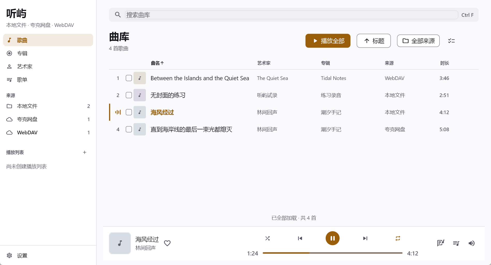
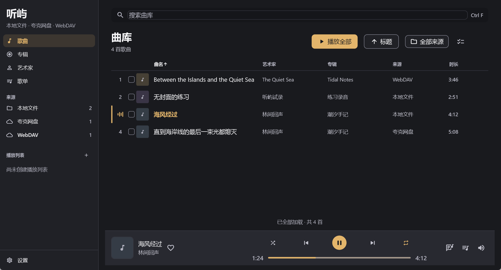
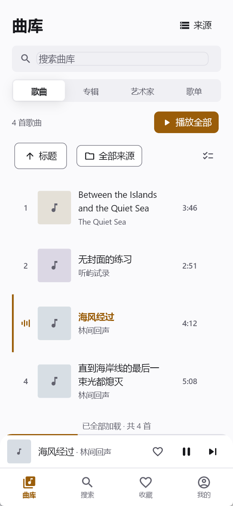
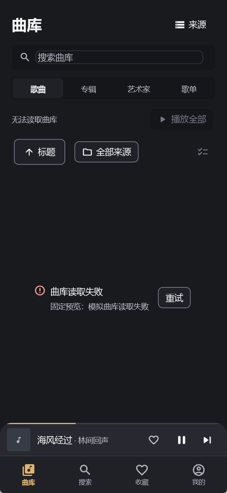

# P3 声档曲库 · 验证结果

记录时间：2026-10-18 21:37（Asia/Shanghai）。分支 `codex/ui-p3-library`，基线提交 `8706cf1bed53c05e6a4767ebaa2e9d9f0b5b47f4`。详细文件哈希与机器读数见 [capture-manifest.json](capture-manifest.json)，SDK 与系统版本见 [environment.txt](environment.txt)。

## 结论

曲库首页的实现、响应式截图、关键交互测试、Windows 生产构建和真实本地播放冒烟已经执行。列策略已按 P2 的 864 / 708 / 560 / 460 内容宽度边界复核；艺术家进入副标题时，来源仍保留独立列。当前状态为“等待用户审查最终视觉并决定是否批准 Golden”：没有把静态分析、Widget 测试或无障碍树查询写成视觉验收通过，也没有更新 Golden 基准。

## 实际截图

Windows DPI 为 1.5。桌面客户区为 1898×1024 物理像素（约 1265×683 逻辑像素），手机为 585×1266（390×844 逻辑像素），medium 为 1200×1289（800×859 逻辑像素）。这些是 Windows 固定视口，不是 Android/iOS 真机证据。

| 场景 | 截图 | 审查结论 |
|---|---|---|
| 桌面 Light | [1898×1024](desktop-light/library-songs.png) | 全列、品牌侧栏、内联搜索、来源与播放条层次清楚；长标题与艺术家有独立间距 |
| 桌面 Dark | [1898×1024](desktop-dark/library-songs.png) | 石墨分层和浅琥珀强调可识别；输入、按钮与表格边界可见 |
| Medium Light | [1200×1289](desktop-medium-light/library-songs.png) | 800dp 窗口内按实际内容宽度收起专辑、艺术家独立列；艺术家进入副标题，来源列保留 |
| 手机 Light | [585×1266](mobile-light/library-songs.png) | 四段导航、两层工具区、56dp 封面和双行标题成立；副标题默认只显示艺术家 |
| 手机 Dark | [585×1266](mobile-dark/library-songs.png) | 控件与正文保持分层，播放中的音柱和琥珀曲名可辨认 |
| 手机 200% 字号 | [585×1266](mobile-scale2/library-songs.png) | 无 RenderFlex 溢出；排序与来源收进“筛选与排序”，播放、来源、导航仍可达 |
| 手机空库 | [585×1266](mobile-empty/library-songs.png) | 显示真实 0 首；播放全部和多选禁用；添加来源入口保留 |
| 手机读取失败 | [585×1266](mobile-error/library-songs.png) | 标题为“无法读取曲库”，显示原因与重试；播放全部和多选禁用 |










固定数据不访问网络。封面来自 `app/tool/fixtures/voice-archive-cover.png`；截图生成时禁用动画，曲目、来源和播放进度固定。

生产入口可能显示本机真实曲库，因此生产冒烟只保留机器读数、stdout/stderr 与可访问性探针日志，不把运行时截图或合成音频写入仓库。上面八张设计证据全部来自不访问网络的固定预览入口，并显示同一组 4 首虚构曲目。

## 视觉审查与修复

| 图名 / 区域 | 问题类型 | 严重性 | 修复要求 | 结果 |
|---|---|---|---|---|
| 桌面曲库 · 曲名/艺术家列 | 排版相接 | 高 | 在独立列之间保留可辨识间距，长标题只能在自己的列内省略 | 已增加 12dp 间距并重拍 |
| 手机曲库 · 行副标题 | 信息密度 / 规范偏差 | 高 | 默认只显示艺术家；筛选来源后补充必要来源上下文 | 已按 P2 修正，测试与截图通过 |
| 手机曲库 · 200% 工具区 | 响应式换行 | 中 | 收起普通排序/来源按钮，保留单一“筛选与排序”和多选入口 | 已完成一轮局部返工并复核 |
| Medium 曲库 · 表格列 | 内容宽度 / 规范偏差 | 高 | 严格按 P2 依次收起专辑、艺术家、来源；艺术家进入副标题时来源列不能随之消失 | 864/863、708/707、560/559、460/459 边界与 650dp 渲染回归通过，medium 截图已重拍 |
| 空库 / 失败态 | 状态表达 | 中 | 错误不要显示为加载；不可操作项必须禁用 | 截图与状态测试通过 |

## 命令与退出码

工作目录均为 `F:\project\tingyu\app`，Windows Release 构建与冒烟在仓库根目录执行。原始日志已保存。

日志内容保持原样；为满足仓库 whitespace 门禁，只移除了行尾空格与文件末尾多余空行。

| 检查 | 命令 | 退出码 | 结果 |
|---|---|---:|---|
| 静态分析 | `flutter analyze` | 0 | [analyze.txt](analyze.txt)：No issues found |
| 重点回归 | `flutter test test/form_factor_test.dart test/library_page_redesign_test.dart test/performance_regression_test.dart test/search_page_test.dart test/ui_rebuild_seek_test.dart` | 0 | [targeted-tests.txt](targeted-tests.txt)：34/34 |
| 全量非 Golden | `flutter test --exclude-tags golden`，共 353 项 | 1 | [full-tests.txt](full-tests.txt)：352 通过，1 个环境失败 |
| Golden 只校验 | `flutter test --run-skipped -t golden test/golden/core_pages_golden_test.dart` | 1 | [golden-test.txt](golden-test.txt)：9 通过，3 个预期待批准差异 |
| Preview Release | Windows host engine，入口 `tool/voice_archive_preview.dart` | 0 | [preview-build.txt](preview-build.txt) |
| Production Release | [build-windows-engine.ps1](../../../tools/build-windows-engine.ps1) 的 `App` 阶段 | 0 | [production-build.txt](production-build.txt) |
| 生产冒烟 | [windows-smoke-test.ps1](../../../tools/windows-smoke-test.ps1)，10 cycles | 0 | [production-smoke.txt](production-smoke.txt) |

全量测试唯一失败是既有环境问题：

```text
source_adapter_cache_test.dart: 来源配置变化或凭据写入后重建适配器
ProcessException: 系统找不到指定的文件。
Command: chmod 600 ...\credentials\webdav_password_s1.txt
```

该失败发生在 `SecureStore._writeFile`，没有为了通过测试而修改断言或削弱权限逻辑。

## Golden 待批准差异

本轮没有执行 `--update-goldens`。旧基准保留在 `app/test/golden/goldens/`，失败截图与差异图保存在 [golden-diffs](golden-diffs/)。

| 用例 | 像素差异 | 差异说明 |
|---|---:|---|
| `library-songs-expanded-dark` | 10.71% | 曲库接入声档页头、内联搜索、工具区、来源列和新表格层次 |
| `library-songs-compact-light` | 26.59% | 手机曲库重排为声档四段导航、两层工具区与双行歌曲行 |
| `stage-compact-dark` | 100.00% | 已实施声档播放页与旧 P0 基准的整体差异；不是本轮曲库新增改动 |

这些差异是设计与实现的待审查产物，不是 Golden 已通过。只有用户明确批准对应最终视觉后，才能单独更新基准并重跑回归。

## 生产冒烟

- 探针内 `processId=18156`，`cyclesAttempted=10`，记录时 `exited=false`；探针写完后由证据清理步骤终止进程。
- 播放引擎为 `media_kit (libmpv)`；最后快照为 `processing=ready playing=true`。
- 120 秒本地 WAV 实际播放到约 19.43 秒，队列总时长 120000ms。
- 原始结论见 [result.json](production-smoke/result.json)，标准输出与错误分别见 [stdout.log](production-smoke/stdout.log)、[stderr.log](production-smoke/stderr.log)；生产截图与 WAV 已从仓库删除。
- UIA 查询未记录 `Failed to update ui::AXTree`，但只找到一个具名元素；这不是人工读屏通过结论。

## 限制

- 尚未在 Android、iOS、macOS 或 Linux 实机执行响应式、字体回退、播放与手势验证。
- 尚未使用控制凭据验证真实夸克网盘与 WebDAV 远程解析和播放；本轮来源名称来自固定预览。
- 尚未完成人工 Narrator/VoiceOver/TalkBack 走查、全键盘焦点顺序审查和真实设备 200% 字号审查。
- 真实桌面截图受本机屏幕限制，约 1265×683 逻辑像素；标准 1440 视口由 Widget 测试覆盖，不能把两者混写。
- 截图证明固定夹具下的当前渲染，不证明整个产品已达到商业品质，也不替代用户对最终设计的确认。

## 下一阶段

1. 用户审查本页桌面、手机、Dark、200% 与状态截图，提出具体视觉问题或批准当前实现。
2. 获批后为两个曲库 Golden 单独建立批准记录并更新基准；播放舞台旧基准仍需按 P3 播放页流程处理。
3. 下一组迁移来源管理页，复用现有 `sourcesProvider`、同步状态、登录/配置界面与路由，继续保持单页提交和回退节点。
4. 在受控环境补真实 WebDAV、夸克播放和各平台冒烟；随后补人工读屏和视觉对比验收。
