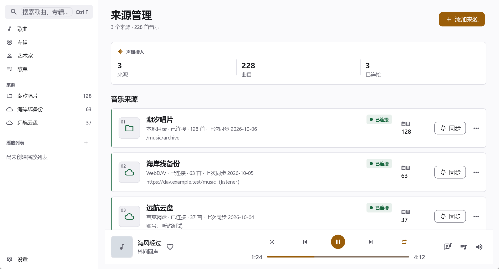
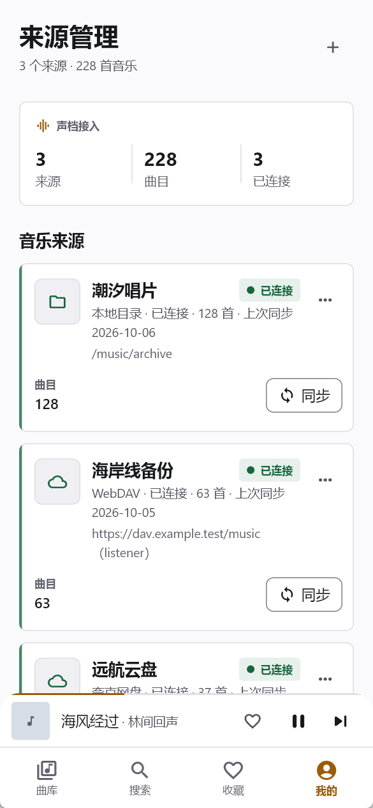
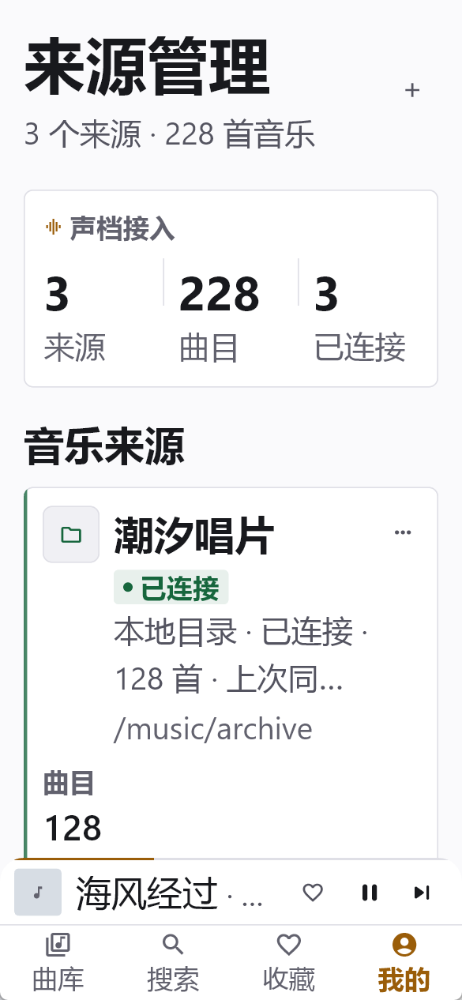
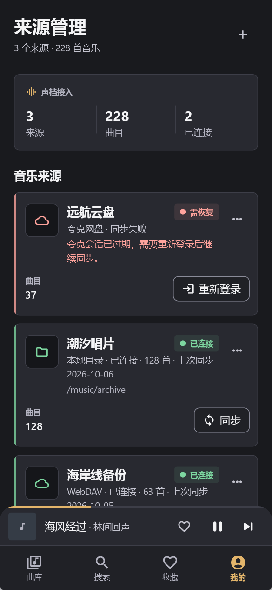
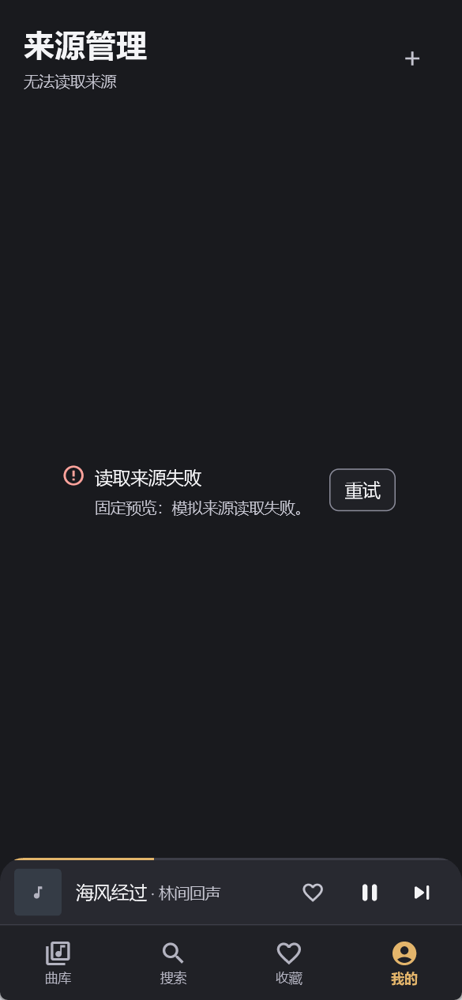

# P3 声档来源管理 · 验证结果

记录时间：2026-10-18 22:03（Asia/Shanghai）。分支
`codex/ui-p3-sources`，基线提交
`ac44d791e1999f0815b3feeca9348f0462840573`。机器读数、全部文件哈希和门禁退出码
见 [capture-manifest.json](capture-manifest.json)，系统与 SDK 版本见
[environment-final.txt](environment-final.txt)。

## 结论

来源管理页已完成声档视觉迁移、固定数据预览、九张实际运行截图、一次局部视觉返工、
回归测试、生产构建和本地播放冒烟。页面继续使用原有来源 provider、同步控制器、路由、
协议实现和凭据存储。

当前没有已知的阻塞性视觉问题，但来源页视觉与 Golden 仍等待用户单独批准。Golden
只执行校验，没有执行更新。播放舞台继承的 100% 差异也继续保持待批准状态。

## 实际截图

Windows DPI 为 1.5。桌面客户区为 1898×1024 物理像素（约 1265×683 逻辑像素），
medium 为 1200×1289（800×859 逻辑像素），手机为 585×1266（390×844 逻辑像素）。
这些是 Windows 固定视口，不是 Android/iOS 真机证据。

| 场景 | 状态 | 截图 | 审查结论 |
|---|---|---|---|
| 桌面 Light | normal | [1898×1024](desktop-light/sources.png) | 侧栏、摘要、三张来源卡和播放条层级完整，长路径不挤压操作区 |
| 桌面 Dark | normal | [1898×1024](desktop-dark/sources.png) | 石墨分层、琥珀强调、状态徽标与边框可辨 |
| Medium Light | normal | [1200×1289](desktop-medium-light/sources.png) | 800dp 内容宽度下保留完整来源信息与操作，窄版侧栏不遮挡卡片 |
| 手机 Light | normal | [585×1266](mobile-light/sources.png) | 摘要、卡片、同步按钮和底部导航可读，第三张卡按预期进入滚动区域 |
| 手机 200% 字号 | normal | [585×1266](mobile-scale2/sources.png) | 来源名与状态徽标分层，主操作独占一行，无 RenderFlex 溢出 |
| 手机空态 | empty | [585×1266](mobile-empty/sources.png) | 三种来源入口完整，说明文字清晰，页面可滚动 |
| 桌面同步中 | syncing | [1898×1024](desktop-syncing-dark/sources.png) | 总览切换为“同步中”，卡片显示 184/320 确定进度与扫描状态 |
| 手机会话失效 | relogin | [585×1266](mobile-relogin-dark/sources.png) | 失败来源位于首位，“重新登录”在首屏可见，错误原因完整 |
| 手机读取失败 | error | [585×1266](mobile-error-dark/sources.png) | 明确显示读取失败、清理后的原因与重试入口，不含内部异常前缀 |











固定数据不访问数据库、网络或真实凭据。来源名称、路径、账号、曲目数和日期全部来自
[source_archive_fixtures.dart](../../../app/tool/source_archive_fixtures.dart)；
截图生成时关闭动画。每个状态的 PNG、字节数、物理/逻辑尺寸、文本倍率和 SHA256 均
记录在 [capture-manifest.json](capture-manifest.json) 的 `captures` 数组中。

## 视觉审查与修复

| 图名 / 区域 | 问题类型 | 严重性 | 明确修复要求 | 结果 |
|---|---|---|---|---|
| 手机 200% · 来源名称与状态 | 响应式 / 排版 | 高 | 状态徽标不能在名称右侧挤压标题；放大文字时另起一行 | 已修复，重新截图并使用位置断言验证 |
| 手机 relogin · 首屏恢复 | 交互效率 | 高 | 首屏必须能看见失败来源及“重新登录” | 夹具改为失败来源置顶；首屏可见 |
| 手机 error · 原因文案 | 状态表达 | 中 | 用户界面不能显示 `Bad state:` 等内部前缀 | 已清理并增加专项测试 |
| 固定夹具 · 同步时间 | 可复现性 | 中 | 截图数据不能依赖当前日期 | 已固定为 2026-10-04/05/06 |

本轮触发一次自动返工。返工后重新执行格式化、静态分析、来源重点回归、预览构建和九张
截图重拍；第二轮复核没有发现需要继续修改的具体问题。没有为了消除差异而放宽断言、
隐藏错误或更新 Golden。

## 命令与退出码

除特别说明外，命令工作目录均为 `F:\project\tingyu\app`。原始日志保存在本目录。
文本日志仅移除行尾空白以满足仓库 whitespace 门禁，命令输出内容和退出状态未改写。

| 检查 | 命令或范围 | 退出码 | 结果 |
|---|---|---:|---|
| 格式化只校验 | `dart format --output=none --set-exit-if-changed <7 files>` | 0 | [format-final.txt](format-final.txt)：0 changed |
| 静态分析 | `flutter analyze` | 0 | [analyze-final.txt](analyze-final.txt)：No issues found |
| 重点回归 | 来源页、来源 ID、同步与响应式共 4 个测试文件 | 0 | [targeted-tests-final.txt](targeted-tests-final.txt)：23/23 |
| 全量非 Golden | `flutter test --exclude-tags golden` | 1 | [full-tests-final.txt](full-tests-final.txt)：360 通过、1 个环境失败 |
| Golden 只校验 | `flutter test --run-skipped -t golden test/golden/core_pages_golden_test.dart` | 1 | [golden-test-final.txt](golden-test-final.txt)：10 通过、2 个待批准差异 |
| 固定预览构建 | Windows host engine，入口 `tool/voice_archive_preview.dart` | 0 | [preview-build-final.txt](preview-build-final.txt) |
| 生产 Release | `tools/build-windows-engine.ps1 -Stage App` | 0 | [production-build-final.txt](production-build-final.txt) |
| 生产冒烟 | `tools/windows-smoke-test.ps1`，10 cycles | 0 | [production-smoke-final/result.json](production-smoke-final/result.json) |

全量测试唯一失败是既有 Windows 环境问题：

```text
source_adapter_cache_test.dart: 来源配置变化或凭据写入后重建适配器
ProcessException: 系统找不到指定的文件。
Command: chmod 600 ...\credentials\webdav_password_s1.txt
```

失败发生在 `SecureStore._writeFile` 调用 `chmod`。本轮没有修改测试断言或降低凭据
权限要求来掩盖该失败。

## Golden 状态

| 用例 | 只校验结果 | 当前状态 |
|---|---:|---|
| `sources-expanded-light` | 14.31% 差异 | 来源页重构尚未获用户视觉批准；基准未更新 |
| `stage-compact-dark` | 100.00% 差异 | 继承自播放页迁移，继续等待单独批准；基准未更新 |

差异图保存在 [golden-diffs-final](golden-diffs-final/)；原始输出和退出码见
[golden-test-final.txt](golden-test-final.txt) 与
[golden-test-final.exit.txt](golden-test-final.exit.txt)。本轮没有运行
`--update-goldens`。

## 生产冒烟

- 探针内 `processId=15732`，`cyclesAttempted=10`，记录时 `exited=false`。
- 播放引擎为 `media_kit (libmpv)`；最后快照为 `processing=ready playing=true`。
- 120 秒本地 WAV 实际播放到约 19.51 秒，队列总时长为 120000ms。
- 标准输出与错误分别见 [stdout.log](production-smoke-final/stdout.log) 和
  [stderr.log](production-smoke-final/stderr.log)。
- 探针结束后已终止进程。生产入口截图和生成的 WAV 已从仓库删除，固定夹具截图保留。
- UIA 查询没有记录 `Failed to update ui::AXTree`，但记录到的具名元素数量不能作为
  人工读屏通过结论。

## 限制与审批

- 尚未在 Android、iOS、macOS 或 Linux 实机执行响应式、字体回退、手势和播放验证。
- 尚未使用受控凭据验证真实夸克网盘与 WebDAV 的认证、扫描和远程播放。
- 尚未完成人工 Narrator/VoiceOver/TalkBack、完整键盘焦点顺序和真实设备 200% 字号走查。
- 固定截图只证明当前 Windows 夹具渲染；Widget 测试和静态分析不能替代视觉验收。
- 来源页最终视觉与 `sources-expanded-light` Golden 需要用户明确批准；播放舞台也需要
  另一项独立批准。
- 当前实现没有改写数据库、播放引擎、来源协议、凭据存储或 Riverpod 架构。
